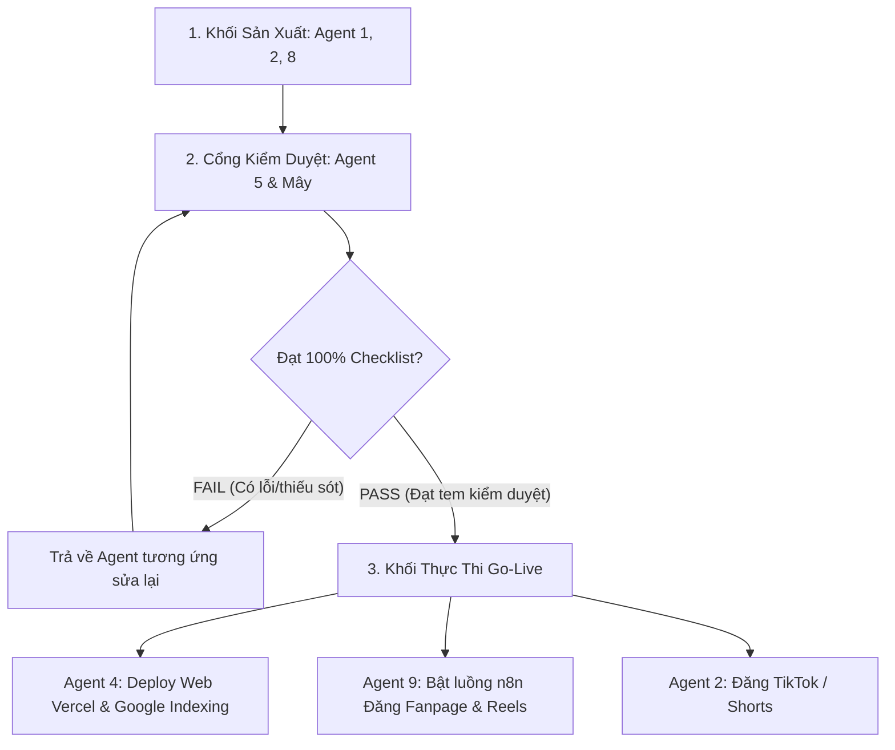

# 🛡️ BỘ TIÊU CHUẨN KIỂM DUYỆT CHẤT LƯỢNG ĐA KÊNH TRƯỚC KHI GO-LIVE (QUALITY AUDIT PROTOCOL)

> **Cơ quan kiểm duyệt tối cao:** **Mây (Tổng Biên Tập)** & **Agent 5 (Kiểm Toán Trưởng - Content & Quality Auditor)**  
> **Nguyên tắc bất di bất dịch:** **KHÔNG CÓ TEM DUYỆT PASS 100% TỪ AGENT 5 & MÂY = TUYỆT ĐỐI CẤM GO-LIVE (KHÔNG PUSH GIT, KHÔNG ĐĂNG BÀI, KHÔNG UPLOAD MEDIA)**.

---

## 🏛️ SƠ ĐỒ QUY TRÌNH KIỂM DUYỆT BẮT BUỘC (4 CỔNG CHẶN)



---

## 📋 4 BẢNG TIÊU CHUẨN KIỂM DUYỆT THEO TỪNG KÊNH CỤ THỂ

### CỔNG 1: BÀI VIẾT NỘI DUNG WEBSITE (AGENT 1 → AGENT 5 → AGENT 4)
*Trước khi Agent 4 đưa vào `src/data/articles.ts`, build tĩnh và push Git, Agent 5 phải rà soát qua 10 chốt chặn thép:*
- [ ] **1. Độ dài chuẩn:** Đạt tối thiểu **2.500 từ** (chuẩn mực 2.800 - 3.800 từ cho các bài chuyên sâu, đếm từ thực tế, không tính code hay cú pháp rác).
- [ ] **2. Tiêu đề chuẩn 2 dòng (Curiosity Hook):** Độ dài vàng **50 – 62 ký tự**. Vừa khít 2 dòng ở box card ngoài, tuyệt đối không bị cắt cụt ba chấm `...`.
- [ ] **3. Vị trí khối "Những Điểm Chính":** Bắt buộc nằm ở **dưới cùng bài viết**, ngay sau *"Lời nhắn gửi từ Trại Cai Nghiện"*. Tuyệt đối không đặt ở đầu hay giữa bài.
- [ ] **4. CẤM TUYỆT ĐỐI HÌNH ẢNH DẠNG KÝ TỰ / TEXT ART / MERMAID / ASCII (LỆNH ĐẶC BIỆT CỦA BỐ):**
  - CẤM 100% các khối mã ````mermaid````, sơ đồ vẽ bằng ký tự chữ (`╭───╮`, `▲`, `│`, `└──►`, `┌`, `└`). Trên web và di động, chúng sẽ vỡ layout và biến thành văn bản rác mắt.
  - Mọi sơ đồ, biểu đồ, chu kỳ 4 giai đoạn, mô hình tâm lý học... **BẮT BUỘC PHẢI LÀ FILE ẢNH PICTURE THẬT SỰ (.webp)**, thiết kế chuẩn mỹ cảm Zen Minimalist, lưu tại `public/images/articles/` và nhúng bằng cú pháp ``.
- [ ] **5. CẤM TUYỆT ĐỐI KÝ TỰ LATEX & CÔNG THỨC RÁC MẮT:**
  - CẤM 100% cú pháp `$\rightarrow$`, `$$...$$`, `\mathbf`, `\text{...}`.
  - Tất cả mũi tên diễn đạt phải dùng ký tự unicode sạch `→`.
  - Công thức số học phải viết bằng số mũ tự nhiên (ví dụ: `1,01³⁶⁵ = 37,78`).
- [ ] **6. CẤM TUYỆT ĐỐI BẢNG BIỂU MARKDOWN THÔ (`| :--- |`):**
  - Không dùng cú pháp bảng kẻ `| :--- |` thô ráp. Bắt buộc chuyển hóa thành văn phong so sánh đối chiếu mộc mạc hoặc vẽ thành infographic picture.
- [ ] **7. Quy tắc 4 KHÔNG:** Không phán xét đạo đức/lười biếng; không dùng từ ngữ self-help sáo rỗng (*tần số rung động, chuyển hóa đỉnh cao*); không kết án vấp ngã; không lý thuyết suông.
- [ ] **8. Văn phong thực chiến:** Chuẩn *"Nói chuyện cà phê vỉa hè nhưng trí tuệ viện nghiên cứu"* (Street-Smart Academic). Dẫn chứng đời thực (ngón tay quẹt 2h sáng cay xè mắt, bát phở 30k, chiếc điện thoại úp mặt).
- [ ] **9. Móc câu giữ chân (Retention):** Giữ nhịp câu biến hóa, có câu hỏi lửng (Open Loops) giữa các phần.
- [ ] **10. SEO On-page:** Từ khóa xuất hiện tự nhiên trong Title, Slug, H1, H2; Meta Excerpt 140 - 160 ký tự; gắn đa danh mục (`categories: [...]`); có ít nhất 2 - 3 link nội bộ và nút CTA dẫn tới bài trắc nghiệm.

---

### CỔNG 2: THỊ GIÁC & HÌNH ẢNH VISUAL (AGENT 8 → AGENT 5)
*Trước khi bất kỳ hình ảnh nào được gắn vào bài viết web hoặc làm cover media:*
- [ ] **1. ĐỒNG BỘ 100% TRANH VẼ MÀU NƯỚC THỦY MẶC Á ĐÔNG (ZEN MINIMALIST WATERCOLOR & SUMI-E INK WASH) — LỆNH ĐẶC BIỆT CỦA BỐ:**
  - **CẤM TUYỆT ĐỐI:** Ảnh chụp thực tế (photostock Unsplash/Pexels của máy tính, điện thoại, bàn làm việc, người ngồi văn phòng), ảnh render 3D hiện đại hoặc hình minh họa màu sắc lòe loẹt.
  - **BẮT BUỘC:** 100% hình ảnh là tranh vẽ màu nước thủy mặc mộc mạc, tĩnh lặng trên nền giấy cổ ấm áp (`#FAF7F2`), nét vẽ mực sumi-e thanh thoát kết hợp sắc xanh rêu rừng (`#3A5A40`) và đất nung (`#C27D53`).
- [ ] **2. Cơ chế chống Cache trình duyệt & CDN (Cache-Busting URL):** Khi thay đổi/cập nhật hình ảnh, bắt buộc phải đổi tên file sang định danh mới (ví dụ: `-zen-`, `-v2.webp`) để trình duyệt và CDN không hiển thị lại ảnh cũ trong bộ nhớ đệm.
- [ ] **3. Bản quyền & Độc bản:** Không dùng ảnh mạng vi phạm bản quyền. Hình ảnh phải được sinh ra từ tư duy ẩn dụ triết học / đời thực đúng với chủ đề bài viết.
- [ ] **4. Dấu chìm nhận diện thương hiệu (Watermarks):**
  - Góc trên bên trái: Huy hiệu `🌿 TRẠI CAI NGHIỆN` (nền tối mờ, chữ trắng).
  - Góc dưới bên phải: Huy hiệu tên miền `traicainghien.com`.
- [ ] **5. Kỹ thuật SEO Hình Ảnh & Dung Lượng:** Tỷ lệ chuẩn **16:9** (`1200x675px`), định dạng **WebP**, dung lượng tối ưu **BẮT BUỘC DƯỚI 120KB**, tên file chứa từ khóa không dấu ngăn cách bằng gạch nối (`tu-khoa-zen-trai-cai-nghien.webp`), đầy đủ thẻ `alt`.

---

### CỔNG 3: MEDIA & VIDEO NGẮN VIRAL (AGENT 2 $\rightarrow$ AGENT 5 $\rightarrow$ AGENT 9)
*Trước khi dựng video hoặc đưa kịch bản vào luồng render tự động n8n/CapCut:*
- [ ] **1. Hook 3 giây đầu tiên:** Đánh trúng trực diện nỗi đau hoặc nghịch lý bất an (mắt cay xè lúc nửa đêm, mở 20 tab đơ não, cảm giác tội lỗi sau khi lướt short video).
- [ ] **2. Tối ưu giọng đọc AI (TTS):** Lời thoại viết câu ngắn, ngắt nhịp thở rõ ràng, dùng từ ngữ mộc mạc, không dùng từ ngữ trúc trắc khiến máy đọc bị vấp.
- [ ] **3. Bản quyền âm nhạc (Tối quan trọng):** 100% nhạc nền là Lo-fi Ambient thuộc kho **No-Copyright Music** (miễn phí bản quyền thương mại). Tuyệt đối cấm nhạc thị trường dính bản quyền Meta/TikTok.
- [ ] **4. Cảnh quay B-roll:** Đúng phong cách Zen Faceless (bàn gỗ, phin cà phê nhỏ giọt, trang sách lật chậm, mưa rơi ngoài cửa sổ, góc tĩnh lặng). 100% footage từ Pexels/Pixabay miễn phí bản quyền thương mại.

---

### CỔNG 4: BÀI ĐĂNG FACEBOOK FANPAGE & REELS (AGENT 9 $\rightarrow$ AGENT 5)
*Trước khi kích hoạt luồng webhook n8n hoặc gọi Meta Graph API để publish lên Fanpage:*
- [ ] **1. Cấu trúc bài viết:** 2 dòng đầu có móc câu thị giác lôi cuốn; thân bài ngắt đoạn thoáng đãng 1-2 câu/dòng; dùng icon tối giản (🌿, ☕, 📖).
- [ ] **2. Quy tắc chống bóp tương tác (Anti-Suppression Rule):** **TUYỆT ĐỐI KHÔNG CHÈN LINK TRỰC TIẾP VÀO CAPTION BÀI ĐĂNG**. Link bài viết và link trắc nghiệm bắt buộc phải được đẩy tự động vào **Bình luận đầu tiên (First Comment)** sau khi post thành công.
- [ ] **3. Khung giờ vàng:** Đăng đúng khung giờ đã quy định (Quote Post: 07h00 - 08h00 sáng; Reels Video: 19h30 - 20h30 tối).
- [ ] **4. CTA nhẹ nhàng:** Không mang tính con buôn, chỉ dẫn dắt tự nhiên vào bài trắc nghiệm 25 câu để thấu hiểu bản thân.

---

## 🔒 CƠ CHẾ KHÓA CỨNG TỰ ĐỘNG HÓA TRƯỚC KHI BUILD (PRE-PUBLISH AUTOMATED GATE)

Để đảm bảo **không bao giờ có bài viết lỗi nào có thể lọt lên production**, hệ thống đã tích hợp trực tiếp script kiểm toán tự động vào lệnh build của toàn dự án (`package.json`):

```json
"scripts": {
  "build": "node scripts/audit_all_articles.js && next build"
}
```

### Script kiểm toán `scripts/audit_all_articles.js` tự động quét 100% kho bài viết trước mỗi lần build:
1. **Kiểm tra độ dài:** Đạt tối thiểu **2.500 từ**. Bài nào dưới 2.500 từ lập tức báo FAIL.
2. **Quét ký tự cấm:** Tự động phát hiện và chặn đứng:
   - Khối mã code ````mermaid````
   - Biểu đồ chữ ASCII (`╭───╮`, `▲`, `│`, `└──►`, `┌`, `└`)
   - Cú pháp bảng markdown thô (`| :--- |`)
   - Cú pháp toán LaTeX (`$$...$$`, `\mathbf`, `$\rightarrow$`)
3. **Quét vị trí Khối Điểm Chính:** Nếu khối `NHỮNG ĐIỂM CHÍNH` không nằm ở cuối cùng của bài viết => Lập tức báo FAIL.
4. **Quét file Thumbnail:**
   - File thumbnail phải tồn tại thực tế trên đĩa trong `public/images/articles/`.
   - Dung lượng file **bắt buộc <= 120KB**. Nếu vượt quá 120KB => Lập tức báo FAIL.

> ⛔ **Nguyên tắc cưỡng chế:** Nếu phát hiện dù chỉ 1 lỗi nhỏ trong bất kỳ bài viết nào, script kiểm toán sẽ thoát ngay lập tức với `process.exit(1)`. Lệnh `next build` bị hủy bỏ, ngăn chặn hoàn toàn việc deploy lên Vercel Production cho đến khi nhân sự sửa xong 100%!

---

## 📤 BIÊN BẢN PHÊ DUYỆT MẪU CỦA AGENT 5 (AUDIT REPORT)

Mỗi lần kiểm định, Agent 5 bắt buộc phải xuất biên bản theo định dạng sau trước khi cho phép xuất bản:

```markdown
### 🛡️ BIÊN BẢN KIỂM DUYỆT CHẤT LƯỢNG — AGENT 5 & MÂY
* **Sản phẩm kiểm tra:** [Tên bài viết / Video / Hình ảnh / Post Facebook]
* **Đơn vị thực hiện:** [Agent 1 / Agent 2 / Agent 8 / Agent 9]
* **Kênh dự kiến go-live:** [Website / Facebook Fanpage / Reels / TikTok]

| Tiêu Chuẩn Kiểm Định | Kết Quả | Ghi Chú Cụ Thể |
| :--- | :---: | :--- |
| Độ dài / Thời lượng | PASS / FAIL | [Chi tiết số từ / số giây] |
| Tiêu đề 2 dòng (Curiosity Hook) | PASS / FAIL | [Số ký tự, độ cuốn hút] |
| Vị trí Khối Điểm Chính | PASS / FAIL | [Đã ở cuối bài sau Lời nhắn gửi chưa?] |
| Phong cách Zen & 4 KHÔNG | PASS / FAIL | [Văn phong có bị giáo điều/từ trừu tượng?] |
| Visual & Watermark | PASS / FAIL | [Ảnh 16:9 WebP <120KB, dấu mờ ở góc] |
| Bản quyền âm thanh / Footage | PASS / FAIL | [100% No-Copyright] |
| SEO On-page / First Comment Link | PASS / FAIL | [Đạt chuẩn kỹ thuật] |

👉 **KẾT LUẬN CUỐI CÙNG:** [PASS 100% - CHO PHÉP GO-LIVE] HOẶC [FAIL - YÊU CẦU SỬA CÁC ĐIỂM: ...]
*Chữ ký phê duyệt:* Agent 5 (Kiểm toán trưởng) & Mây (Tổng biên tập)
```
