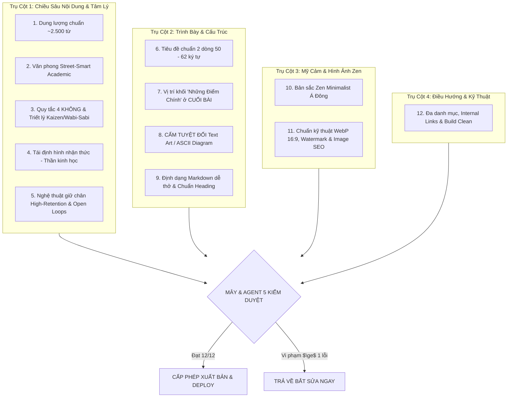

# 🛡️ BỘ TIÊU CHUẨN THẨM ĐỊNH & KIỂM DUYỆT BÀI VIẾT XUẤT BẢN: TRẠI CAI NGHIỆN
> **Người phê duyệt tối cao:** **Mây (AI Co-founder / Tổng Biên Tập)** & **Agent 5 (Kiểm Toán Chất Lượng)**  
> **Áp dụng cho:** Toàn bộ bài viết từ Agent 1 (Content), Agent 8 (Visual), Agent 4 (Tech)  
> **Nguyên tắc bất di bất dịch:** **CHỈ XUẤT BẢN KHI ĐẠT 100% CHECKLIST (PASS 12/12 TIÊU CHÍ). VI PHẠM BẤT KỲ LỖI ĐỎ NÀO $\rightarrow$ REJECT & YÊU CẦU SỬA NGAY.**

---

## 🏛️ MA TRẬN 4 TRỤ CỘT & 12 TIÊU CHÍ VÀNG



---

## 📋 CHI TIẾT 12 TIÊU CHÍ BẮT BUỘC

### TRỤ CỘT 1: CHIỀU SÂU NỘI DUNG & TÂM LÝ HỌC HÀNH VI

#### 1. Dung lượng chuẩn vàng (~2.500 từ/bài)
* **Quy chuẩn:** Bài viết phải đạt dung lượng thực tế khoảng **2.400 đến 2.800 từ**.
* **Ý nghĩa:** Đây là độ dài vàng đủ để mổ xẻ vấn đề từ: Hiện tượng đời thực $\rightarrow$ Nỗi đau chôn giấu $\rightarrow$ Giải mã thần kinh học $\rightarrow$ Cú bẻ lái tái định hình $\rightarrow$ Kế hoạch vi mô Kaizen thực hành.
* **Lỗi đỏ (Reject):** Bài viết dưới 2.000 từ (viết nông, hời hợt) hoặc dài lê thê độn chữ sáo rỗng.

#### 2. Văn phong Street-Smart Academic ("Cà phê vỉa hè, trí tuệ viện nghiên cứu")
* **Quy chuẩn:** Viết như một người bạn tri kỷ ngồi quán cà phê — gần gũi, chân thành, từng trải, nhưng sở hữu tri thức khoa học vững chắc từ Harvard, Stanford, hay các tác giả kinh điển (Anna Lembke, James Clear, Cal Newport, Michael Easter...).
* **Neo đậu bằng chi tiết đời thực trần trụi:** Chiếc điện thoại đầu giường 2h sáng cay xè mắt, tab ẩn danh, ngón tay mỏi nhừ vì quẹt Reels, bát phở 30k, tiếng quạt gió đêm khuya.

#### 3. Bộ lọc "4 KHÔNG" & Tinh thần Chữa lành (Wabi Sabi - Kaizen)
* **KHÔNG phán xét hay đổ lỗi đạo đức:** Tuyệt đối không quy kết *"bạn lười biếng, ý chí kém cỏi"*. Luôn giải thích bằng sinh học thần kinh: đó là phản xạ tự nhiên của bộ não thời đồ đá trước bẫy công nghệ siêu kích thích.
* **KHÔNG dùng ngôn từ self-help sáo rỗng:** Cấm tiệt các từ ngữ đao to búa lớn vô nghĩa (*"tần số rung động"*, *"khai mở tâm thức"*, *"kỷ luật thép"*, *"chiến binh bứt phá đỉnh cao"*).
* **KHÔNG bi kịch hóa lần trượt chân:** Thấm đẫm tinh thần Wabi Sabi — chấp nhận vết rạn, tha thứ hoàn toàn để đứng dậy làm lại từ bước Kaizen 1%.
* **KHÔNG lý thuyết suông:** Mọi khái niệm đều phải đi kèm bài tập thực hành nhỏ đến mức buồn cười (như quy tắc 2 trang giấy, quy tắc 2 mét, thở 3 nhịp).

#### 4. Cú bẻ lái Tái định hình nhận thức (Cognitive Reframing)
* **Quy chuẩn:** Mỗi bài viết phải phá tan một ngộ nhận sai lầm cố hữu của độc giả.
* *Ví dụ:* 
  - *"Bạn không lười, não bạn chỉ đang phản ứng bình thường với một việc không trả lại dopamine ngay lập tức."*
  - *"Việc càng khó, bạn càng không được gồng mình; làm việc khó đỉnh cao nhất là làm như hít thở."*

#### 5. Nghệ thuật giữ chân độc giả (High Retention Writing & Open Loops)
* **Quy chuẩn:** Nhịp điệu câu cú biến hóa liên tục (lúc ngắn gọn dứt khoát, lúc sâu lắng tâm sự).
* **Open Loops:** Cuối mỗi phân đoạn lớn luôn để lại một câu hỏi gợi mở tò mò, khiến người đọc có quán tính tâm lý cuộn màn hình đọc tiếp một mạch đến chữ cuối cùng.

---

### TRỤ CỘT 2: TRÌNH BÀY & CẤU TRÚC BÀI VIẾT

#### 6. Tiêu đề chuẩn 2 dòng (50 – 62 ký tự) & Kích thích tò mò (Curiosity Hook)
* **Độ dài vàng:** Bắt buộc nằm trong khoảng **50 đến 62 ký tự** (tính cả khoảng trắng).
* **Hiển thị giao diện:** Vừa khít 2 dòng hiển thị trên box card bài viết ở trang chủ và kho bài viết, tuyệt đối **không bị tràn dòng gây cắt cụt dấu ba chấm `...`**.
* **Lực hút tò mò:** Sử dụng hình ảnh tương phản hoặc nghịch lý thu hút độc giả (*Nghịch lý Yerkes-Dodson: Việc càng khó càng phải bình tĩnh; Tim Ferriss: Bí quyết 'Hai trang giấy dở tệ' & Khối 3 giờ vàng*).

#### 7. Vị trí khối "Những Điểm Chính" (Key Takeaways) ở CUỐI BÀI
* **Quy tắc bất di bất dịch:** Bắt buộc đặt ở **cuối cùng của bài viết**, ngay sau mục *"Lời nhắn gửi từ Trại Cai Nghiện"*.
* **Cấm:** Tuyệt đối không đặt khối này ở đầu bài, tránh làm lộ kết luận và triệt tiêu cảm xúc tò mò của người đọc trước khi trải qua hành trình thấu cảm.

#### 8. CẤM TUYỆT ĐỐI TEXT ART & ASCII DIAGRAM (LỆNH ĐẶC BIỆT CỦA BỐ)
* **Lỗi đỏ lập tức (Reject 100%):** Nghiêm cấm sử dụng ký tự văn bản / ASCII art (`╭───╮`, `▲`, `│`, `└──►`, v.v.) hoặc các khối code giả lập đồ thị hình chuông, sơ đồ dòng chảy.
* **Lý do:** Trên trình duyệt web và thiết bị di động, text art sẽ bị nhảy dòng, co cụm thành một mớ ký tự hỗn độn, nhem nhuốc, phá nát hoàn toàn thẩm mỹ Zen Minimalist.
* **Cách thể hiện chuẩn:** 
  - Diễn giải bằng văn phong so sánh, gạch đầu dòng in đậm nổi bật (`* **Nhóm 1:** ...`).
  - Nếu là đồ thị / infographic phức tạp: Chuyển giao Agent 8 thiết kế hình ảnh thật.

#### 9. Định dạng Markdown dễ thở & Chuẩn Heading
* **Cấu trúc đoạn văn:** Mỗi đoạn tối đa 2 đến 4 câu. Ngắt dòng thoáng đãng, chống ngợp mắt cho người đọc đêm trên điện thoại.
* **Cú pháp Heading chuẩn:** 
  - `## ` cho Đề mục lớn (H2).
  - `### ` cho Phân mục con (H3).
  - `#### ` cho Ý nhánh chi tiết (H4).
  - **Luôn có dòng trống phân cách** phía trên và phía dưới heading để parser hiển thị chuẩn xác, không bao giờ bị lỗi dính chữ hoặc lộ ký hiệu markdown thô.

---

### TRỤ CỘT 3: MỸ CẢM & QUY CHUẨN HÌNH ẢNH (AGENT 8)

#### 10. Bản sắc Visual Zen Minimalist (Tĩnh lặng Á Đông)
* **Triết lý thị giác:** Cảm giác như bước vào một ngôi nhà gỗ giữa rừng, tách biệt hoàn toàn khỏi sự kích thích ồn ào và nhức mắt của mạng xã hội.
* **Bảng màu nhận diện chính thức:**
  - `Xanh Rêu Rừng (#3A5A40)`: Màu chủ đạo của sự hồi sinh, điềm tĩnh.
  - `Be Ấm / Giấy Mộc (#FAF7F2, #E6E1D8)`: Màu nền ấm áp, chống mỏi mắt.
  - `Đất Nung Mờ (#C27D53)`: Điểm nhấn tinh tế.
  - `Xám Than Trầm (#2D312E)`: Chữ viết mềm mại, không dùng màu đen gắt (#000000).
* **Concept hình ảnh:** Góc tĩnh, phin cà phê, mưa rơi qua ô cửa kính, cuốn sách mở dở trên bàn gỗ mộc, cây xanh trong sương sớm. Không dùng hình ảnh hào nhoáng, xe sang, hay màu sắc neon chói lọi.

#### 11. Chuẩn kỹ thuật Thumbnail & Image SEO
* **Tỷ lệ khung hình:** Chuẩn 16:9 (`1200x675px` hoặc `1200x630px`).
* **Định dạng & Dung lượng:** Bắt buộc định dạng `.webp`, nén dung lượng nhẹ dưới **120KB** để đảm bảo tốc độ tải trang Core Web Vitals tối ưu.
* **Watermark bản quyền:** Đóng dấu thương hiệu nhỏ mờ tinh tế (độ mờ 30% - 40%) ở góc ảnh: `🌿 TRẠI CAI NGHIỆN`.
* **Quy chuẩn đặt tên file SEO:** Chữ thường, không dấu, nối bằng gạch ngang, chứa từ khóa chính + thương hiệu (Ví dụ: `dinh-luat-yerkes-dodson-trai-cai-nghien.webp`).
* **Thẻ Alt Text chuẩn SEO:** Bắt buộc có thẻ Alt tự nhiên mô tả nội dung hình ảnh và chứa từ khóa chính.

---

### TRỤ CỘT 4: ĐIỀU HƯỚNG & HỆ THỐNG KỸ THUẬT

#### 12. Điều hướng liên kết & Đa danh mục
* **Đa danh mục (`categories: [...]`):** Luôn gắn mảng đa danh mục (2-4 chuyên mục liên quan) như `XayDungThoiQuen`, `HieuHanhVi`, `LayLaiSuTapTrung`, `TrietHocCuocSong`, `QuanTriCamXuc`.
* **Liên kết nội bộ (Internal Links):** Tối thiểu 2 đến 3 liên kết ngữ cảnh trỏ đến bài viết liên quan hoặc trang [Trắc nghiệm 25 câu nhận diện dopamine](/trac-nghiem) để giảm Bounce Rate và giữ chân người đọc trong hệ sinh thái.
* **Kiểm tra kỹ thuật hoàn tất:** Pass 100% lệnh `npm run build` không có bất kỳ cảnh báo lỗi cú pháp nào trước khi đẩy lên GitHub và Vercel.

---

## 🚦 QUY TRÌNH KIỂM DUYỆT 3 BƯỚC CỦA MÂY & AGENT 5

```
[BƯỚC 1: SOẠN THẢO] ──► Agent 1 & Agent 8 hoàn thiện bản nháp theo checklist
                                 ↓
[BƯỚC 2: THẨM ĐỊNH] ──► Mây & Agent 5 chạy bảng soi 12 Tiêu chí
                        ├── Có lỗi đỏ (Text art, tiêu đề dài, <2000 từ...) ──► REJECT (Bắt sửa ngay)
                        └── Đạt 12/12 Tiêu chí ──────────────────────────► KÝ DUYỆT (PASS)
                                 ↓
[BƯỚC 3: XUẤT BẢN]  ──► Agent 4 tích hợp articles.ts, build kiểm tra & push deploy tự động
```

---

## 🎯 BẢNG CHẤM ĐIỂM DUYỆT BÀI MẪU (AUDIT REPORT TEMPLATE)

Mỗi khi kiểm duyệt một bài viết mới, Mây và Agent 5 xuất bản biên bản thẩm định ngắn gọn theo mẫu sau:

```markdown
### 📝 BIÊN BẢN KIỂM TOÁN CHẤT LƯỢNG BÀI VIẾT
* **Tiêu đề:** [Tên bài viết] ([Số ký tự] ký tự - Đạt chuẩn 50-62 ký tự: ✅/❌)
* **Số từ thực tế:** [Số từ] từ (Đạt chuẩn ~2.500 từ: ✅/❌)
* **Vị trí Key Takeaways:** Đặt cuối bài (✅/❌)
* **Bộ lọc Text Art:** 100% sạch, không có ASCII diagram (✅/❌)
* **Văn phong & Triết lý:** Street-Smart Academic, thấm đẫm Wabi Sabi / Kaizen (✅/❌)
* **Hình ảnh & SEO:** WebP 16:9, dưới 120KB, có Watermark, Alt Text đầy đủ (✅/❌)
* **Điều hướng & Đa danh mục:** Đầy đủ Internal Links và categories (✅/❌)
* **Build Check:** Pass 100% SSG (✅/❌)
---
👉 **KẾT LUẬN CỦA MÂY & AGENT 5:** [ĐÃ DUYỆT (PASS) / YÊU CẦU SỬA LỖI X]
```
