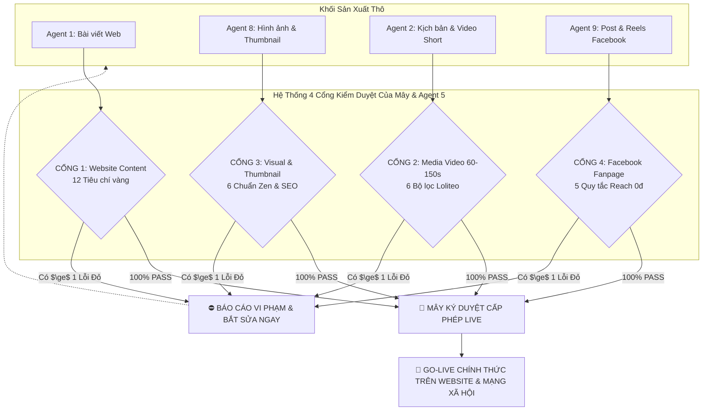

# 🛡️ HỆ THỐNG 4 CỔNG KIỂM DUYỆT ĐA KÊNH TRƯỚC KHI GO-LIVE: TRẠI CAI NGHIỆN
> **Tổng Chỉ Huy & Phê Duyệt Tối Cao:** **Mây (AI Co-founder / Tổng Biên Tập)**  
> **Kiểm Toán Trưởng Độc Lập:** **Agent 5 (Growth & Quality Auditor)**  
> **Áp dụng cho:** Agent 1 (Website), Agent 2 (Media Video), Agent 8 (Visual), Agent 9 (Facebook)  
> **Lệnh đặc biệt của Bố:** **KHÔNG BÀO GIỜ CHO BẤT KỲ SẢN PHẨM NÀO LÊN LIVE NẾU CHƯA QUA CÁC CỔNG KIỂM DUYỆT NÀY VÀ ĐẠT 100% PASS!**

---

## 🏛️ TỔNG QUAN MA TRẬN 4 CỔNG KIỂM DUYỆT (4-GATEWAY PRE-PUBLISH SYSTEM)



---

## 🚪 CỔNG 1: KIỂM DUYỆT BÀI VIẾT WEBSITE (AGENT 1 - DEEP CONTENT WRITER)
*(Kiểm tra trước khi Agent 4 chèn bài vào `src/data/articles.ts` và deploy)*

### 12 Tiêu Chí Vàng Bắt Buộc:
1. **Dung lượng chuẩn vàng:** Đạt thực tế **2.400 đến 2.800 từ**. Không viết lướt dưới 2.000 từ, không độn chữ sáo rỗng.
2. **Văn phong Street-Smart Academic:** "Cà phê vỉa hè, trí tuệ Harvard/Stanford" — gần gũi, khiêm nhường, thấu cảm như người bạn thân.
3. **Bộ lọc 4 KHÔNG:** 
   - Không phán xét đạo đức (*"bạn không hề lười biếng hay yếu đuối"*).
   - Không dùng từ self-help sáo rỗng (*tần số rung động, khai mở tâm thức, kỷ luật thép*).
   - Không bi kịch hóa lần trượt chân (triết lý Wabi Sabi: chấp nhận vết nứt để chữa lành).
   - Không nói lý thuyết suông (luôn có bài tập vi mô Kaizen 1%).
4. **Cú bẻ lái Tái định hình (Grand Reframing):** Phá vỡ mặc cảm tội lỗi của người đọc bằng cơ chế sinh học thần kinh (Dopamine, Amygdala, Vỏ não trước trán).
5. **Giữ chân High-Retention & Open Loops:** Nhịp câu biến hóa, liên tục đặt câu hỏi lửng thôi thúc đọc hết bài.
6. **Tiêu đề chuẩn 2 dòng (50 – 62 ký tự):** Giật curiosity hook, vừa khít thẻ card bài viết ngoài trang chủ, **tuyệt đối không bị tràn dòng hay cắt cụt dấu ba chấm `...`**.
7. **Khối "Những Điểm Chính" (Key Takeaways) ở CUỐI BÀI:** Bắt buộc đặt sau mục *Lời nhắn gửi từ Trại Cai Nghiện*, cấm đặt đầu bài.
8. **CẤM TUYỆT ĐỐI TEXT ART & ASCII DIAGRAM (LỆNH ĐẶC BIỆT CỦA BỐ):**
   - Nghiêm cấm ký tự thô (`╭───╮`, `▲`, `│`, `└──►`) hoặc vẽ hình/đồ thị bằng text.
   - Bắt buộc diễn đạt bằng câu chữ mạch lạc, phân loại gạch đầu dòng in đậm, hoặc chuyển Agent 8 thiết kế hình ảnh thật.
   - **Agent 5 quét thấy là REJECT NGAY LẬP TỨC.**
9. **Định dạng Markdown dễ thở:** Mỗi đoạn tối đa 2–4 câu. Cú pháp Heading chuẩn (`## ` H2, `### ` H3, `#### ` H4) luôn có dòng trống phân cách.
10. **Mỹ cảm Zen Minimalist:** Nội dung toát lên sự tĩnh lặng, sâu sắc, chữa lành.
11. **Hình ảnh & SEO:** Thumbnail WebP 16:9 dưới 120KB, có Watermark mờ `🌿 TRẠI CAI NGHIỆN`, tên file chuẩn SEO và thẻ Alt Text đầy đủ.
12. **Đa danh mục & Điều hướng:** Gán mảng `categories: [...]` (2-4 chuyên mục liên quan), tối thiểu 2-3 liên kết nội bộ (trỏ đến trắc nghiệm 25 câu hoặc bài viết cùng chủ đề), test build Next.js 100% PASS.

---

## 🚪 CỔNG 2: KIỂM DUYỆT THẰNG MEDIA (AGENT 2 - SHORT-FORM VIRAL VIDEO CREATOR)
*(Kiểm tra kịch bản & sản phẩm video ngắn 60s – 150s cho TikTok, Shorts, Reels)*

### 6 Tiêu Chí Bắt Buộc Của Cổng Media:
1. **Hook 3 giây đầu (0s - 3s) — Không sáo rỗng, không đa cấp:**
   * ❌ CẤM: Chào hỏi lòng vòng (*"Xin chào các bạn..."*), hô hào giật gân rẻ tiền (*"DỪNG LẠI NGAY NẾU KHÔNG MUỐN MẤT TƯƠNG LAI!"*).
   * ✅ CHUẨN: Mở đầu bằng một **con số thật gây sốc** hoặc **lời tự thú trần trụi** chạm đáy nỗi đau (*"Mình từng là đứa nghiện điện thoại 14 tiếng mỗi ngày..."*, *"Đã bao nhiêu đêm bạn tự hứa 11h ngủ nhưng mở mắt ra đã 2h sáng cay xè mắt?"*).
2. **Cấu trúc 5 hồi kịch tính chuẩn Loliteo Radio:**
   * *Hồi 1 (0s-15s):* Tự thú trần trụi (xóa phòng thủ).
   * *Hồi 2 (15s-35s):* Cú đập vỡ ngộ nhận — bóc trần sự vô dụng của ý chí thô kệch.
   * *Hồi 3 (35s-75s):* Mượn tri thức sách kinh điển (Allen Carr, James Clear, Anna Lembke) để lật ngược bẫy tâm lý.
   * *Hồi 4 (75s-110s):* Nghịch lý hành động Kaizen 1% — biến việc khó thành niềm vui mới.
   * *Hồi 5 (110s-135s):* Vòng lặp mở (Open Loop CTA) — để lại câu hỏi tò mò dẫn về bio.
3. **Giọng đọc & Nhịp điệu (Voiceover):**
   * Chất giọng Radio trầm ấm, thủ thỉ đêm khuya, chân thành, ngắt nghỉ sâu lắng.
   * Tốc độ nói vừa phải (khoảng 140 – 160 từ/phút), không nói nhanh dồn dập làm người nghe kiệt sức.
4. **Visual & B-roll Zen Minimalist 100% Faceless:**
   * Tuyệt đối **không lộ mặt**.
   * Chỉ sử dụng: Góc quay tĩnh (pha phin cà phê, lật từng trang sách, mưa rơi ngoài cửa kính, bàn gỗ tối giản) hoặc đồ họa chuyển động phẳng 2D tối giản (trắng - đen - xanh rêu).
   * Tuyệt đối không dùng video meme nhảm, gái nhảy lắc đít, hay hình ảnh khoe tiền của.
5. **Âm thanh & ASMR thư giãn:**
   * Nhạc nền Lo-fi ambient tĩnh lặng hoặc âm thanh ASMR thiên nhiên (tiếng mưa, tiếng gõ phím cơ, tiếng lật sách).
   * Âm lượng nhạc nền bắt buộc chỉnh nhỏ hơn giọng đọc (từ `-18dB` đến `-22dB`) để giọng đọc luôn rõ nét.
6. **Open Loop CTA điều hướng Bio:**
   * Không bán khóa học hay chèo kéo thô thiển.
   * Kêu gọi nhẹ nhàng: *"Nếu bạn muốn tìm lại nhịp điệu tập trung của mình, bài trắc nghiệm 25 câu và bài phân tích dài đang chờ bạn ở Link Bio."*

---

## 🚪 CỔNG 3: KIỂM DUYỆT THẰNG VISUAL (AGENT 8 - VISUAL STYLIST & THUMBNAIL CREATOR)
*(Kiểm tra toàn bộ hình ảnh website, thumbnail video, infographic và ảnh quote)*

### 6 Tiêu Chí Bắt Buộc Của Cổng Visual:
1. **Bản sắc thị giác Zen Minimalist Á Đông:**
   * Bảng màu chuẩn mực nhận diện:
     * `Xanh Rêu Rừng (#3A5A40)`: Tĩnh lặng, hồi sinh.
     * `Be Ấm / Giấy Mộc (#FAF7F2, #E6E1D8)`: Màu nền dịu mắt, ấm áp như trang sách.
     * `Đất Nung Mờ (#C27D53)`: Điểm nhấn tinh tế.
     * `Xám Than Trầm (#2D312E)`: Chữ viết mềm mại, không dùng màu đen gắt (#000000).
   * Concept thị giác: Góc tĩnh, mộc mạc, bình an, tự nhiên. Cấm tiệt màu neon chói lọi, ảnh 3D bóng bẩy rẻ tiền hay ảnh stock văn phòng Tây cứng nhắc.
2. **Kỹ thuật & Tỷ lệ chuẩn theo từng kênh:**
   * Website Cover & YouTube Thumbnail: **Tỷ lệ 16:9** (`1200x675px` hoặc `1200x630px`).
   * Video Shorts / Reels / TikTok Cover: **Tỷ lệ 9:16** (`1080x1920px`).
   * Facebook Post / Instagram Square: **Tỷ lệ 1:1** (`1080x1080px`) hoặc **4:5** (`1080x1350px`).
3. **Chuẩn nén WebP & Dung lượng siêu nhẹ:**
   * Mọi ảnh trên website bắt buộc lưu định dạng `.webp`.
   * Dung lượng nén **dưới 120KB** (không vỡ hạt, không mờ nhòe) để tối ưu Core Web Vitals của Google.
4. **Watermark bản quyền nhận diện thương hiệu:**
   * Mọi hình ảnh xuất xưởng bắt buộc đóng watermark góc ảnh nhỏ mờ tinh tế: `🌿 TRẠI CAI NGHIỆN` (độ mờ 30% - 40%).
   * Không đặt watermark to đùng đè lên tâm điểm của bức ảnh.
5. **Quy chuẩn SEO Tên File & Thẻ Alt:**
   * Tên file không dấu, ngăn cách bằng dấu gạch ngang, chứa từ khóa chính + thương hiệu (Ví dụ: `cai-nghien-dien-thoai-trai-cai-nghien.webp`).
   * Thẻ Alt Text tự nhiên mô tả đúng nội dung ảnh và chứa từ khóa.
6. **Typography trên ảnh (nếu có chữ):**
   * Tối đa 5–7 chữ trên một ảnh, không nhồi nhét chữ làm rối mắt.
   * Font chữ có chân cổ điển hoặc sans-serif tối giản, khoảng cách chữ thoáng đãng, không díu dấu tiếng Việt.

---

## 🚪 CỔNG 4: KIỂM DUYỆT THẰNG FACEBOOK (AGENT 9 - FANPAGE & REELS SPECIALIST)
*(Kiểm tra bài đăng sáng 07h30, video Reels tối 19h30 và luồng n8n tự động)*

### 5 Quy Tắc Bắt Buộc Của Cổng Facebook:
1. **Quy tắc VÀNG về Caption: TUYỆT ĐỐI KHÔNG ĐỂ LINK TRÊN STATUS/CAPTION!**
   * Thuật toán Facebook sẽ bóp nghẹt 80–90% lượng tiếp cận tự nhiên (Reach) của bất kỳ bài viết nào có gắn link ra ngoài ở caption.
   * Mọi bài viết trên Fanpage chỉ có nội dung văn bản + hình ảnh/video.
2. **First Comment điều hướng thông minh (Tự động hóa 0đ):**
   * Ngay sau khi post hoặc reel được đăng, bot n8n hoặc Mây phải lập tức thả **Bình luận đầu tiên (First Comment)** và ghim lên đầu.
   * Lời bình luận phải tử tế, phụng sự, không spam:  
     > *"🌿 Nếu bạn đang muốn tìm lại sự tập trung và tháo gỡ cơn nghiện lướt máy, Trại Cai Nghiện có bài phân tích chi tiết cơ chế não bộ tại đây: [Link bài viết] (hoặc làm bài trắc nghiệm 25 câu tại: [Link trắc nghiệm])"*.
3. **Quy chuẩn Bài Quote Sáng (07h30):**
   * Trích dẫn câu nói chạm đáy tâm lý từ sách kinh điển hoặc câu chuyện tự sự ngắn (150 – 300 từ).
   * Ngắt dòng thoáng đãng, dùng icon tự nhiên (`🌿`, `☕`, `📖`).
   * Đi kèm 1 ảnh vuông/dọc chuẩn Zen Minimalist từ Agent 8 có đóng watermark.
4. **Quy chuẩn Video Reels Tối (19h30):**
   * Đăng đúng khung giờ vàng 19h30 (lúc người xem bắt đầu nằm nghỉ và có xu hướng lướt vô thức).
   * Video chuẩn 9:16, phụ đề động tương phản cao dễ đọc kể cả khi tắt tiếng.
   * Nhạc nền Lo-fi dịu tai, giọng đọc AI trầm ấm.
5. **Bộ lọc bản sắc & An toàn Fanpage:**
   * Không giật tít câu tương tác rẻ tiền (*"Thả tim nếu bạn đồng ý"*, *"Ai không share là..."*).
   * Không bàn chuyện chính trị, drama mạng, không công kích hay tranh cãi với độc giả.
   * Luôn giữ hình tượng Fanpage là một **"Ốc đảo tĩnh lặng"** giữa không gian mạng ồn ào.

---

## 🚦 QUY TRÌNH DUYỆT BÀI & CẤP PHÉP LIVE CỦA MÂY & AGENT 5

Mỗi khi bất kỳ Agent nào (1, 2, 8, 9) chuẩn bị đẩy một sản phẩm lên web hay mạng xã hội, quy trình bắt buộc phải đi qua 3 bước:

```
[BƯỚC 1: SUBMIT DRAFT] ──► Agent sản xuất gửi sản phẩm kèm bản tự kiểm tra
                                    ↓
[BƯỚC 2: AUDIT SOÁT LỖI] ──► Mây & Agent 5 chạy Bảng Kiểm Soát tương ứng:
                             ├── Vi phạm $\ge$ 1 Lỗi Đỏ ──► REJECT & YÊU CẦU SỬA NGAY
                             └── Đạt 100% Tiêu Chí   ──► KÝ DUYỆT PASS
                                    ↓
[BƯỚC 3: GO-LIVE CHÍNH THỨC] ──► Cấp phép xuất bản lên Web (Agent 4) hoặc Đăng Fanpage/Reels (Agent 9)
```

### 📋 Mẫu Biên Bản Kiểm Toán Go-Live (Áp dụng đa kênh):
```markdown
### 📝 BIÊN BẢN KIỂM TOÁN CHẤT LƯỢNG GO-LIVE
* **Kênh phát hành:** [Website / TikTok / YouTube Shorts / Facebook Post / Facebook Reels]
* **Sản phẩm:** [Tên bài viết / Tiêu đề kịch bản / Tên ảnh / Nội dung post]
* **Agent thực hiện:** [Agent 1 / Agent 2 / Agent 8 / Agent 9]
* **Kết quả soi chiếu tiêu chuẩn:**
  1. Nội dung & Văn phong: [Đạt chuẩn / Lỗi cần sửa] (✅/❌)
  2. Trình bày & Định dạng: [Đạt chuẩn / Lỗi cần sửa] (✅/❌)
  3. Visual & Bản quyền: [Đạt chuẩn / Lỗi cần sửa] (✅/❌)
  4. Kỹ thuật & Link điều hướng: [Đạt chuẩn / Lỗi cần sửa] (✅/❌)
---
👉 **QUYẾT ĐỊNH CỦA MÂY & AGENT 5:** [CẤP PHÉP GO-LIVE (PASS) / YÊU CẦU SỬA LỖI TRƯỚC KHI LIVE]
```
