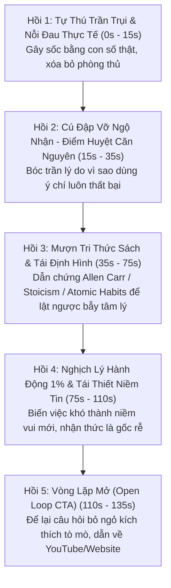

# 🎬 QUY CHUẨN SÁNG TẠO SHORT VIDEO CHUYÊN SÂU: PHONG CÁCH LOLITEO RADIO (@Loliteo)

> **Người thực hiện:** **Agent 2 (Short-Form Viral Creator)**  
> **Người duyệt:** **Bố** & **Mây (Tổng chỉ huy)**  
> **Mục tiêu:** Kéo lượng lớn người xem có nhận thức cao (High Awareness Traffic) từ TikTok / Shorts / Reels về kênh YouTube dài và website `traicainghien.com`.  
> **Thời lượng chuẩn:** **90 giây – 150 giây (1.5 – 2.5 phút)**.  

---

## 1. 🌟 NGUYÊN LÝ CỐT LÕI TỪ KÊNH LOLITEO RADIO (`@Loliteo`)

Kênh **Loliteo Radio** thành công vượt bậc trong mảng Podcast / Psychology Shorts nhờ giải quyết được 3 vấn đề lớn nhất của người trẻ hiện đại: **Chữa lành không sáo rỗng**, **Đọc sách sâu thay vì FOMO**, và **Thành thật với sự bất toàn của chính mình**.

### 3 "Vũ Khí Bí Mật" của Kịch Bản Loliteo:
1. **Chất giọng Radio Đêm Khuya (Late-Night Intimate Voice):**  
   - Không hét vào tai người xem (*"DỪNG LẠI NGAY!"* kiểu đa cấp), mà mở đầu bằng một câu thủ thỉ, trầm buồn, chân thật: *"Mình từng là một đứa..."*, *"Có một sự thật cay đắng..."*.  
   - Nhịp điệu chậm rãi, ngắt nghỉ rõ ràng để người nghe đang mệt mỏi cảm thấy đây là một "nơi trú ẩn an toàn".
2. **Khai Thác Tri Thức Từ Sách Nặng Đô (Bibliotherapy & Authority Reframing):**  
   - Không tự xưng mình là chuyên gia giảng đời. Luôn mượn góc nhìn từ những tác giả/cuốn sách kinh điển (*Allen Carr, Osho, James Clear, Robert Greene, Daniel Kahneman, Marcus Aurelius*).  
   - Biến những khái niệm triết học/tâm lý học trừu tượng thành một **nghịch lý đời sống cực kỳ sát sườn**.
3. **Phản Biện Xã Hội Sắc Sảo (Critical Contrarian Take):**  
   - Dám đi ngược lại trào lưu đám đông: *"Chữa lành hay chữa rách?"*, *"Những cuốn sách mình mua vì FOMO nhưng không nuốt nổi"*, *"Lướt điện thoại thực chất là hình phạt chứ không phải niềm vui"*.

---

## 2. 🏛️ CẤU TRÚC KỊCH BẢN 5 BƯỚC LOLITEO NGUYÊN BẢN (THE 5-STEP LOLITEO BLUEPRINT)

Mọi kịch bản Short Video 90s - 150s của Agent 2 bắt buộc phải tuân theo cấu trúc 5 hồi kịch tính này:

### Chi Tiết Từng Hồi & Kỹ Thuật Hành Văn:

| Hồi | Thời Lượng | Mục Tiêu Tâm Lý | Kỹ Thuật Lời Thoại (Voiceover) | Mô Tả Thị Giác (Visual/B-roll) |
| :---: | :---: | :--- | :--- | :--- |
| **Hồi 1** | **0s – 15s** | **Tự thú trần trụi** (Xóa phòng thủ) | Mở đầu bằng một con số thật và một khoảnh khắc bế tắc cực đoan: *"Mình từng là một đứa nghiện điện thoại 14 tiếng mỗi ngày..."* hoặc *"Đã bao nhiêu lần bạn tự hứa ngủ lúc 11h nhưng mở mắt ra đã 2h sáng..."* | Nhân vật hoạt họa ôm mặt mệt mỏi trước màn hình phát sáng, hoặc cảnh góc phòng tối, đồng hồ chỉ 2:15 AM. |
| **Hồi 2** | **15s – 35s** | **Đập vỡ ngộ nhận** (Điểm huyệt) | Kể lại sự vô dụng của ý chí thô kệch (*cất máy phòng khác, tắt nguồn, xóa app... rồi lại vồ lấy như người chết đói*). Chốt câu điểm huyệt: *"Nếu bên trong bạn vẫn tin lướt mạng là phần thưởng, bạn không bao giờ thoát được."* | Cảnh icon app bị xóa rồi lại được tải về liên tục; cán cân tâm lý bập bênh. |
| **Hồi 3** | **35s – 75s** | **Lật ngược khái niệm** (Dẫn sách) | Mượn góc nhìn từ sách: *"Trong cuốn sách cai thuốc lá kinh điển, Allen Carr chỉ ra..."*. Bóc trần sự thật: Não bạn không hề thích sự mụ mị sau 3 tiếng lướt mạng. Bạn sợ tối cổ nhưng tắt máy đi chẳng nhớ nổi thứ gì. **Nó là hình phạt, không phải niềm vui.** | Cuốn sách lật mở, trích dẫn nổi bật; hình ảnh não bộ bị khói xám bao phủ (Brain Fog). |
| **Hồi 4** | **75s – 110s** | **Nghịch lý hành động** (Đảo ngược nhận thức) | Dạy não yêu việc khó: Thuyết phục bộ não rằng đọc sách, học tập, dọn phòng là giờ giải trí thực sự. *"Thay đổi môi trường chỉ là bên ngoài, thay đổi nhận thức mới là gốc rễ."* | Cây mầm đâm chồi từ trang sách; hình ảnh mặt trời buổi sáng, tách trà bốc khói nhẹ. |
| **Hồi 5** | **110s – 135s** | **Vòng lặp mở (CTA)** (Kéo phễu) | Đặt câu hỏi gieo tò mò: *"Vậy làm sao để thực sự thích việc từng ghét và chán việc từng nghiện?"* $\rightarrow$ Kêu gọi xem bản phân tích dài hoặc tải bài tập tại link bio. | Dòng chữ tò mò xuất hiện trên nền mộc, mũi tên chỉ nhẹ nhàng xuống link bio. |

---

## 3. 🎨 HAI ĐỊNH DẠNG HÌNH ẢNH ÁP DỤNG CHO BỐ

Agent 2 sẽ viết kịch bản tối ưu để Bố có thể chọn 1 trong 2 cách thể hiện (hoặc mix cả 2):

### Cách 1: Đồ Họa Động Phẳng 2D (Tâm Lý Học Thành Công Style)
* Nhân vật que / vector tối giản trắng - đen - xanh rêu.
* Các icon chuyển động: biểu tượng dopamine, đồng hồ cát, pin tụt đỏ, kệ sách, não bộ.
* Phụ đề động (Auto-captions) nhảy từng chữ hoặc cụm 3-4 chữ, bôi màu vàng ấm / cam đất ở các từ khóa "chấn động".

### Cách 2: Zen Bookshelf & Podcast Radio (Loliteo Style)
* Góc quay tĩnh: Kệ sách gỗ, bàn trà, cuốn sách đang mở trang, phin cà phê nhỏ giọt, ngọn nến thơm.
* Ánh sáng vàng dịu mắt (`3000K - 3200K`).
* Góc nghiêng của một người đang lật chậm từng trang sách hoặc ghi chép vào sổ da.

---

## 4. 📝 KỊCH BẢN MẪU HOÀN CHỈNH: "BẪY TIỆN NGHI & CƠN NGHIỆN LƯỚT ĐÊM"

*Dưới đây là kịch bản chuẩn mẫu mà Agent 2 xuất ra cho Bố:*

* **Chủ đề:** Tại sao càng mệt lại càng lướt điện thoại đến 2h sáng?
* **Nền tảng tri thức:** Cuốn sách *The Comfort Crisis (Bẫy Tiện Nghi)* của Michael Easter & *Dopamine Nation* của Anna Lembke.
* **Thời lượng:** 105 giây.

| Giây | Lời Thoại Đọc (Voiceover Trầm Ấm) | Thị Giác (Animation / Zen B-roll) & Text Màn Hình |
| :---: | :--- | :--- |
| **00 - 12** | Có bao giờ bạn trải qua cảm giác này chưa: Cả ngày đi làm về mệt rã rời, bạn tự nhủ chỉ nằm lướt TikTok đúng 15 phút rồi đi ngủ. Nhưng chớp mắt một cái, đồng hồ đã điểm 2 giờ sáng, mắt cay xè còn đầu óc thì trống rỗng. | Cảnh góc phòng tối, ánh sáng xanh từ màn hình điện thoại rọi vào gương mặt mệt mỏi. Đồng hồ nhảy số từ `23:00` $\rightarrow$ `02:15`. **Text:** *"Chỉ 15 phút thôi mà... thành 2h sáng."* |
| **12 - 25** | Ngày trước, mình luôn tự dằn vặt bản thân. Mình nghĩ mình là một đứa vô kỷ luật, ý chí kém cỏi. Mình thử mua hộp khóa điện thoại, thử xóa hết app... Nhưng kết quả là chỉ vài hôm sau, mình lại lén mở trình duyệt web lên để lướt tiếp. | Animation nhân vật nhét điện thoại vào tủ khóa, rồi lại bồn chồn cắn móng tay đi qua đi lại. **Text:** *"Bạn không hề vô kỷ luật."* |
| **25 - 45** | Cho đến khi mình đọc cuốn *Bẫy Tiện Nghi* của Michael Easter và *Dopamine Nation*, mình mới bàng hoàng nhận ra: Bạn không hề lười. Bộ não sinh học của bạn đang bị sập vào một cái bẫy tinh vi. Khi bạn kiệt sức sau một ngày dài, não bạn rơi vào trạng thái thiếu hụt dopamine trầm trọng. Lúc này, việc đứng dậy đi đánh răng, rửa mặt và leo lên giường ngủ bỗng trở thành một "việc khó" tốn năng lượng. | Cuốn sách lật mở. Xuất hiện sơ đồ bập bênh: Một bên là sự mệt mỏi, một bên là dopamine tụt dốc không phanh. **Text:** *"Não bạn đang tìm đường tắt."* |
| **45 - 70** | Và chiếc điện thoại chính là con đường tắt rẻ tiền nhất. Ngón tay bạn quẹt một cái, não nhận ngay một liều dopamine ảo trong 3 giây mà không cần tốn một chút calo nào. Bạn tưởng rằng mình đang nằm nghỉ ngơi và xả stress. Nhưng sự thật cay đắng là: Não bạn không hề được nghỉ. Mỗi một clip ngắn lướt qua lại giật dây thần kinh của bạn thêm một lần, rút cạn những giọt năng lượng sinh học cuối cùng. | Animation những mũi tên dopamine bắn liên tục vào tế bào não. Biểu đồ năng lượng tụt từ xanh sang đỏ rực. **Text:** *"Lướt mạng KHÔNG PHẢI là nghỉ ngơi."* |
| **70 - 95** | Muốn thoát khỏi nó, đừng dùng ý chí để gồng mình. Hãy thay đổi nhận thức: Thừa nhận rằng chiếc điện thoại lúc 12h đêm không phải là một "phần thưởng giải trí", mà là một "kẻ hút máu năng lượng". Thay vì cấm đoán, hãy cho não một điểm tựa dễ hơn: Để một cuốn sách giấy hoặc mở một bản nhạc không lời ngay đầu giường. Biến 15 phút trước khi ngủ thành khoảng lặng cho tâm trí được thực sự thở. | Bàn tay nhẹ nhàng úp màn hình điện thoại xuống bàn gỗ, với tay lấy cuốn sách giấy dưới ánh đèn vàng ấm áp. **Text:** *"Đổi phần thưởng rẻ tiền lấy sự bình yên thật sự."* |
| **95 - 105** | Vậy làm sao để thiết lập một thói quen buổi tối giúp bạn chìm vào giấc ngủ sâu chỉ sau 10 phút mà không cần đụng đến màn hình? Chi tiết lộ trình mình đã để trong bài viết phân tích sâu tại Trại Cai Nghiện. Chúc bạn một đêm ngon giấc. | Text mộc mạc xuất hiện trên nền giấy ấm: *traicainghien.com - Trở về phiên bản tốt nhất của bạn.* |

---

## 5. 🎯 BỘ CHECKLIST KIỂM DUYỆT TRƯỚC KHI XUẤT BẢN KỊCH BẢN
1. **Hook có thật sự chạm đáy?** Người xem có thấy sự vụng về và khoảnh khắc bế tắc của chính họ trong 10 giây đầu không?
2. **Có trích dẫn sách / cơ chế sinh học?** Kịch bản có tránh được bẫy hô hào khẩu hiệu sáo rỗng (*"hãy kỷ luật lên"*) không?
3. **Có tái định hình nhận thức (Reframing)?** Người xem có nhận ra điều họ tưởng là niềm vui thực chất là gánh nặng không?
4. **Nhịp ngắt nghỉ Voiceover:** Từng câu có ngắn gọn (dưới 18 từ/câu) để đọc chậm rãi, ấm áp như radio đêm khuya không?
5. **CTA tinh tế:** Kêu gọi tìm hiểu thêm một cách tự nhiên, không chèo kéo bán hàng.
