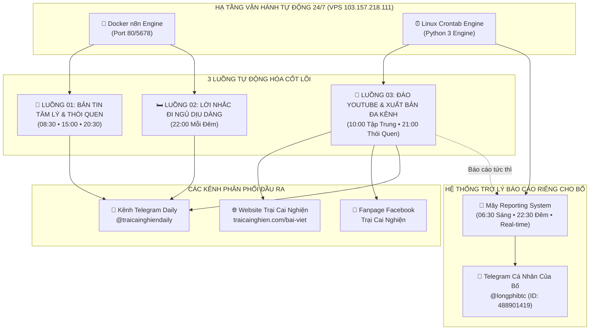

# 🌿 TỔNG HỢP KIẾN TRÚC & HỆ THỐNG TỰ ĐỘNG HÓA N8N — TRẠI CAI NGHIỆN
> **Tài liệu chuẩn hóa chính thức:** Master Index Automation Flows  
> **Phiên bản:** 2.0.0 | **Ngày cập nhật:** 08/11/2026  
> **Quản trị viên:** Bố Long & Mây (AI Co-founder)  
> **Hạ tầng máy chủ:** VPS CentOS Linux (`103.157.218.111`), Docker n8n Engine & Next.js Vercel CDN

---

## 1. 🗺️ BẢN ĐỒ TỔNG THỂ CÁC LUỒNG TỰ ĐỘNG HÓA (MASTER ARCHITECTURE)

Hệ thống tự động hóa của Trại Cai Nghiện được thiết kế thành **3 LUỒNG TỰ ĐỘNG CỐT LÕI** vận hành khép kín, kèm theo **1 HỆ THỐNG TRỢ LÝ BÁO CÁO RIÊNG** kết nối trực tiếp với Telegram cá nhân của Bố:



---

## 2. 📋 BẢNG TRA CỨU NHANH 3 LUỒNG TỰ ĐỘNG (QUICK INDEX TABLE)

| Mã Luồng | Tên Luồng Tự Động | Khung Giờ (VN) | Nền Tảng Chạy | Kênh Xuất Bản | Tài Liệu Chi Tiết |
| :---: | :--- | :---: | :---: | :---: | :---: |
| **FLOW_01** | **Bản Tin Tâm Lý & Thói Quen** | 08:30<br>15:00<br>20:30 | Docker n8n (`wWXJoMhbchKzrkqr`) | Telegram Channel | [📄 Chi tiết Luồng 01](file:///c:/Users/MrFine/Documents/Traicainghien/docs/automation-flows/flow_01_daily_psychology_news.md) |
| **FLOW_02** | **Lời Nhắc Đi Ngủ Dịu Dàng** | 22:00 | Docker n8n (`E6PVBHKrtYPlfevu`) | Telegram Channel | [📄 Chi tiết Luồng 02](file:///c:/Users/MrFine/Documents/Traicainghien/docs/automation-flows/flow_02_bedtime_gentle_reminder.md) |
| **FLOW_03** | **Đào YouTube & Xuất Bản Đa Kênh** | 10:00<br>21:00 | Docker n8n (`Lj3wvfAe0CEqnWbQ`)<br>+ Bridge Engine (`:5005`) | Web + Fanpage + Telegram | [📄 Chi tiết Luồng 03](file:///c:/Users/MrFine/Documents/Traicainghien/docs/automation-flows/flow_03_omnichannel_publishing_engine.md) |
| **REPORTER** | **Trợ Lý Riêng Báo Cáo Cho Bố** | 06:30<br>22:30<br>Real-time | Python (`telegram_reporter.py`) | Telegram Bố (`@longphibtc`) | Tích hợp trong Luồng 03 |

---

## 3. 🕒 DÒNG THỜI GIAN VẬN HÀNH 24 GIỜ (24-HOUR TIMELINE)

```text
[06:30] 🌅 TRỢ LÝ BÁO CÁO: Kế hoạch ngày mới, tiến độ 3 đầu việc (Web, FB, Nhóm) và chỉ số tương tác đa kênh gửi riêng cho Bố.
[08:30] ☀️ LUỒNG 01 (SÁNG): Bản tin tâm lý khởi động ngày mới, Ikigai, 60 phút không màn hình (Telegram Channel).
[10:00] 🚀 LUỒNG 03 (CHUYÊN ĐỀ 1): Tự động đào YouTube video triệu view về "TẬP TRUNG & DEEP WORK" ➔ Xuất bản Web ➔ Đăng Facebook kèm ảnh & ghim First Comment ➔ Đăng Kênh Telegram ➔ Nhắn riêng link cho Bố.
[15:00] ☕ LUỒNG 01 (CHIỀU): Bản tin tâm lý chiều, trị sương mù não sau bữa trưa, kỹ thuật Pomodoro 45/10 (Telegram Channel).
[20:30] 🌙 LUỒNG 01 (TỐI): Bản tin tâm lý tối, nhận diện bẫy dopamine rẻ tiền, thói quen buông bỏ (Telegram Channel).
[21:00] 🚀 LUỒNG 03 (CHUYÊN ĐỀ 2): Tự động đào YouTube video triệu view về "THÓI QUEN & ATOMIC HABITS" ➔ Xuất bản Web ➔ Đăng Facebook kèm ảnh & ghim First Comment ➔ Đăng Kênh Telegram ➔ Nhắn riêng link cho Bố.
[22:00] 🛏️ LUỒNG 02 (ĐÊM): Lời nhắc đi ngủ dịu dàng, tắt điện thoại và tranh Japandi ấm cúng (Telegram Channel).
[22:30] 📊 TRỢ LÝ BÁO CÁO: Báo cáo kiểm toán tổng hợp ngày, thống kê số bài xuất bản và sức khỏe VPS (CPU, RAM, Uptime) gửi riêng cho Bố.
```

---

## 4. 🗂️ MỤC LỤC CHI TIẾT CÁC LUỒNG & ĐẶC TÍNH KỸ THUẬT

### 🌊 [Luồng 01: Bản Tin Tâm Lý & Thói Quen Định Kỳ (08:30, 15:00, 20:30)](file:///c:/Users/MrFine/Documents/Traicainghien/docs/automation-flows/flow_01_daily_psychology_news.md)
* **Mục đích:** Cung cấp kiến thức tâm lý ngắn gọn, thực hành Kaizen vi mô 1% mỗi ngày.
* **Cơ chế đặc thù:**
  * Thu thập tin tức thời gian thực từ Google News RSS quốc tế.
  * Node Code lưu trữ bộ nhớ tĩnh `$getWorkflowStaticData('global')` để **chống trùng lặp 100% link bài đã gửi**.
  * Bóc tách thông tin bài báo, **tuyệt đối không dùng ảnh stock báo nước ngoài** (như ảnh đeo khẩu trang y tế, ảnh công sở Tây).
  * **100% sử dụng kho 64+ tranh vẽ tay Zen Watercolor độc bản của Trại Cai Nghiện** kèm cơ chế chống trùng lặp bộ nhớ (`sentPhotos`), tự động loại trừ mọi ảnh đã xuất hiện trong 60 ngày gần nhất.
  * Caption HTML giới hạn nghiêm ngặt **dưới 1024 UTF-16 code units** tránh lỗi Telegram Bad Request.

### 🛏️ [Luồng 02: Lời Nhắc Đi Ngủ Dịu Dàng (22:00 Mỗi Đêm)](file:///c:/Users/MrFine/Documents/Traicainghien/docs/automation-flows/flow_02_bedtime_gentle_reminder.md)
* **Mục đích:** Nghi thức tắt màn hình, tạo ranh giới số và hỗ trợ người dùng có giấc ngủ sâu.
* **Cơ chế đặc thù:**
  * Bức tranh vẽ tay độc bản chuẩn Japandi Minimalist (`bedtime_gentle_bedroom.webp`, 98KB).
  * Lời nhắc nhủ mang tính chữa lành, tôn trọng, không mang màu sắc quân phiệt hay mệnh lệnh hà khắc.
  * Nhắc nhở khoa học: Tắt ánh sáng xanh để kích hoạt hormone Melatonin tự nhiên.

### 🚀 [Luồng 03: Đào YouTube & Xuất Bản Đa Kênh (10:00 & 21:00)](file:///c:/Users/MrFine/Documents/Traicainghien/docs/automation-flows/flow_03_omnichannel_publishing_engine.md)
* **Mục đích:** Cỗ máy sản xuất nội dung dài chuyên sâu (Long-form content engine) chuẩn SEO và tương tác cao.
* **Cơ chế đặc thù:**
  * Dùng `yt-dlp` và `youtube-transcript-api` cào phụ đề video triệu view mà không mất phí API.
  * Tái cấu trúc thành bài viết sâu sắc cho Website `traicainghien.com/bai-viet/{slug}`.
  * Đẩy tự động lên GitHub qua **SSH Deploy Key** (`traicainghien-vps-deploy`) để Vercel build tự động.
  * Đăng bài Facebook Fanpage dạng **Curiosity Gap** kèm ảnh full-size khổ lớn (`/photos`) và **tự động ghim First Comment** chứa link Web & Telegram (chống bóp tương tác).
  * Báo cáo link tức thì về Telegram riêng của Bố (`@longphibtc`).

---

## 5. 🔑 DANH BẠ HẠ TẦNG & TÀI KHOẢN KẾT NỐI (INFRASTRUCTURE DIRECTORY)

### Máy Chủ VPS (CentOS Linux):
* **Địa chỉ IP:** `103.157.218.111` (Domain: `vn1.1921992.xyz`)
* **SSH Port:** `11985` | **User:** `root` | **Password:** `TCN@Root2026#Secure`
* **Cơ chế bảo vệ (Port Knocking):** Gửi HTTP GET tới `http://103.157.218.111:60000/C1sco1234` kèm `User-Agent: Mozilla/5.0` trước khi kết nối SSH. Mở IP trong 24 giờ.

### Docker n8n Engine:
* **Container Name:** `n8n` (Phiên bản v2.45.7)
* **Port ánh xạ:** `0.0.0.0:80 -> 5678/tcp`
* **Đường dẫn dữ liệu nội bộ:** `/home/node/.n8n/database.sqlite`
* **Tài khoản Owner:** `may@traicainghien.com` / `Traicainghien2026@`

### Xác Thực GitHub (Deploy Key):
* **Tên Key trên GitHub:** `VPS Trai Cai Nghien` (Quyền: `Read/write`)
* **File Private Key trên VPS:** `/root/.ssh/id_traicainghien_deploy`
* **Cấu hình SSH:** `/root/.ssh/config` cấu hình `Host github.com` sử dụng chìa khóa này.
* **Repository:** `git@github.com:longphi11/traicainghien-1.git`

### Facebook Fanpage Token:
* **Page Name:** *Trại Cai Nghiện* (Page ID: `1232949796570940`)
* **Page Access Token:** Vĩnh viễn không bao giờ hết hạn (`Expires: Never`). Lưu trong `.env.local` biến `FB_PAGE_ACCESS_TOKEN`.

### Telegram Bot & Channel:
* **Bot Quản Trị:** `@May_TraiCaiNghien_bot` (`9249970693:AAEm8Fm77TROqU81PRhfWThlSqguMMZcfYs`)
* **Kênh Phát Sóng:** `@traicainghiendaily` (ID: `-1004488309634`)
* **Telegram Cá Nhân Của Bố:** `@longphibtc` (ID: `488901419`)

---

## 6. 🛠️ SỔ TAY XỬ LÝ LỖI & BẢO TRÌ NHANH (DEBUGGING PLAYBOOK)

### Khi Kênh Telegram không có bài lúc 08:30 / 15:00 / 20:30:
1. Đăng nhập VPS kiểm tra log container n8n:
   ```bash
   docker logs --tail 50 $(docker ps -q -f name=n8n)
   ```
2. Nếu workflow bị inactive, chạy lệnh kích hoạt lại:
   ```bash
   docker exec -it $(docker ps -q -f name=n8n) n8n publish:workflow --id=wWXJoMhbchKzrkqr
   docker restart $(docker ps -q -f name=n8n)
   ```

### Khi Bài Viết trên Web bị lỗi 404 sau khung 10:00 / 21:00:
1. Kiểm tra log của dispatcher:
   ```bash
   cat /root/traicainghien/cron_focus.log # hoặc cron_habit.log
   ```
2. Kiểm tra xem VPS đã `git push` thành công chưa:
   ```bash
   cd /root/traicainghien && git status
   git push origin main
   ```
3. Kiểm tra kiểm toán hình ảnh có bị trùng lặp không:
   ```bash
   npm run audit:articles
   ```

### Khi Bố cần kiểm tra tình trạng tương tác đa kênh ngay lập tức:
* Chạy lệnh trên máy chủ hoặc terminal:
  ```bash
  python3 scripts/telegram_reporter.py --type engagement
  ```
  *(Hệ thống sẽ ngay lập tức tổng hợp số liệu Web, Fanpage, Telegram và gửi vào nick Bố trong 3 giây).*

---

## 7. 📜 NGUYÊN TẮC THÉP KHI THAY ĐỔI HOẶC NÂNG CẤP LUỒNG

1. **🛑 NGUYÊN TẮC CÁCH LY PHẠM VI DỰ ÁN (LỆNH ĐẶC BIỆT CỦA BỐ):**
   - **Máy chủ VPS (`103.157.218.111`) và Docker n8n là môi trường dùng chung (Multi-tenant) cho NHIỀU DỰ ÁN KHÁC NHAU của Bố.**
   - **TUYỆT ĐỐI KHÔNG ĐƯỢC CHẠM VÀO, CHỈNH SỬA, BẬT/TẮT, XÓA BỎ HOẶC CAN THIỆP BẤT KỲ ĐIỀU GÌ** liên quan đến các workflow, cơ sở dữ liệu, credentials, file hoặc tiến trình không thuộc về dự án Trại Cai Nghiện.
   - **Chỉ thao tác đúng 3 Workflow chính thức của Trại Cai Nghiện:**
     * `Flow 01: Bản Tin Tâm Lý Học` (ID: `wWXJoMhbchKzrkqr`)
     * `Flow 02: Lời Nhắc Đi Ngủ 22h00` (ID: `E6PVBHKrtYPlfevu`)
     * `Flow 03: Đào YouTube & Xuất Bản Đa Kênh` (ID: `Lj3wvfAe0CEqnWbQ`)
   - Nghiêm cấm mọi lệnh xóa hàng loạt (Bulk/Wildcard commands) như `delete --all`, `pkill`, `prune volumes`... làm ảnh hưởng đến các dự án khác của Bố.

2. **Quy tắc Single Source of Truth:** Bất kỳ thay đổi nào về lịch trình, logic hay thông số của luồng tự động đều phải được cập nhật đồng thời tại file tổng `AUTOMATION_FLOWS_N8N.md` và file chi tiết tương ứng (`flow_01_*.md`, `flow_02_*.md`, `flow_03_*.md`).
3. **Kiểm tra giới hạn ký tự Telegram:** Mọi bản tin phát sóng kèm ảnh lên Telegram bắt buộc giữ độ dài UTF-16 code units **dưới 1024** để tránh lỗi ngắt kết nối `400 Bad Request`.
4. **Quy chuẩn Hình ảnh độc bản (LỆNH ĐẶC BIỆT CỦA BỐ):** 
   - 100% hình ảnh đưa vào bài viết web hoặc bài phát sóng Telegram Channel (@traicainghiendaily) phải là **tranh vẽ tay Thủy mặc Zen Watercolor độc bản**, không dùng ảnh chụp stock người thật (ảnh đeo khẩu trang, bệnh viện), không dùng vector 2D phẳng hay 3D bóng bẩy.
   - **Tuyệt đối cấm trùng lặp ảnh trên kênh Telegram:** Mỗi bài đăng bắt buộc phải mang một hình ảnh duy nhất, được chọn lọc qua bộ lọc chống trùng lịch sử phát sóng (`sentPhotos`). Không lặp lại ảnh trong vòng ít nhất 60 ngày.
