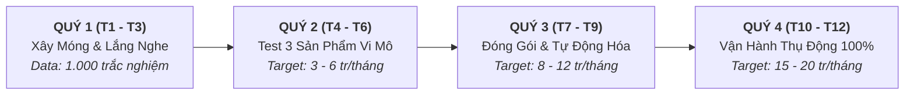

# 🌿 BẢN ĐỒ CHIẾN LƯỢC & KẾ HOẠCH THỰC THI 1 NĂM (12 THÁNG)
## DỰ ÁN: TRẠI CAI NGHIỆN (traicainghien.com)
> **Người sáng lập & Điều hành:** Bố  
> **Đồng sáng lập AI & Hỗ trợ kỹ thuật:** Mây  
> **Mục tiêu tối thượng (North Star):** Xây dựng cỗ máy tự động hóa (Automation & Faceless) tạo ra dòng tiền thụ động bền vững **15.000.000 – 20.000.000 VNĐ/tháng**.  
> **Chiến lược cốt lõi:** *"Đi chậm, đánh chắc — Dành 3 đến 6 tháng đầu thử nghiệm vi mô để tìm đúng sản phẩm thị trường khao khát (Product-Market Fit), sau đó mới tự động hóa và tăng tốc."*

---

## 📊 BẢNG ĐIỀU KHIỂN TIẾN ĐỘ TỔNG THỂ (OVERALL DASHBOARD)

| Giai Đoạn | Thời Gian | Trọng Tâm Chiến Lược | Mục Tiêu Doanh Thu | Trạng Thái |
| :--- | :---: | :--- | :---: | :---: |
| **Quý 1** | Tháng 1 – 3 | Xây móng nội dung & Thu thập dữ liệu nỗi đau độc giả | **0 VNĐ** (Xây niềm tin) | 🟡 Đang thực hiện |
| **Quý 2** | Tháng 4 – 6 | Phòng thử nghiệm 3 sản phẩm vi mô (Micro-Testing Lab) | **3 – 6 triệu/tháng** (Test thị trường) | ⚪ Chưa bắt đầu |
| **Quý 3** | Tháng 7 – 9 | Đóng gói bản hoàn chỉnh & Kích hoạt phễu tự động hóa | **8 – 12 triệu/tháng** | ⚪ Chưa bắt đầu |
| **Quý 4** | Tháng 10 – 12 | Tối ưu toàn diện, chạy thụ động 100% & Cán đích mục tiêu | **15 – 20 triệu/tháng** | ⚪ Chưa bắt đầu |

*Ký hiệu trạng thái: 🟢 Hoàn thành | 🟡 Đang thực hiện | ⚪ Chưa bắt đầu | 🔴 Tạm hoãn/Điều chỉnh*

---

## 🗺️ CHI TIẾT KẾ HOẠCH TỪNG GIAI ĐOẠN

---

### 🌱 QUÝ 1 (THÁNG 1 – 3): XÂY MÓNG NỘI DUNG & THĂM DÒ THỊ TRƯỜNG
> **Mục tiêu lớn nhất:** Không bán bất cứ thứ gì. Tập trung làm bạn, trao giá trị miễn phí và dùng bài trắc nghiệm làm "ăng-ten" đo lường chính xác độc giả đang đau đớn nhất vì thói quen nào.

#### 1.1. Nền Tảng Kỹ Thuật & Website
- [x] Triển khai website chính thức tại `https://www.traicainghien.com`.
- [x] Tích hợp bài trắc nghiệm 20 câu 4 chặng (`/trac-nghiem`) phân tích mức độ kiệt quệ Dopamine.
- [x] Xuất bản 5 bài viết chuyên sâu mở đầu chuẩn SEO và khoa học hành vi (`/bai-viet`).
- [ ] Thiết lập hệ thống lưu trữ dữ liệu trắc nghiệm ẩn danh (Google Sheets/Supabase) để thống kê tỷ lệ mắc các chứng nghiện.
- [ ] Cài đặt Google Analytics / Search Console để theo dõi từ khóa độc giả tìm kiếm.

#### 1.2. Kênh Truyền Thông Vệ Tinh (Faceless Content)
- [ ] Xây dựng 1 kênh TikTok & 1 kênh YouTube Shorts mang phong cách tĩnh lặng (Zen Faceless):
  - Định dạng: B-roll tối giản (pha cà phê, đọc sách, góc làm việc, mưa rơi) + Giọng đọc AI trầm ấm + Phụ đề nổi bật.
- [ ] Thử nghiệm 4 cụm nội dung (Content Pillars) để đo lượng tương tác:
  - [ ] **Cụm 1: Nghiện Dopamine rẻ tiền / Mạng xã hội / Doomscrolling** (Bài viết & video giải mã bập bênh khoái cảm - nỗi đau).
  - [ ] **Cụm 2: Cám dỗ thầm kín / Porn & Thủ dâm quá độ** (Giải mã hiệu ứng Coolidge, xóa bỏ mặc cảm tội lỗi).
  - [ ] **Cụm 3: Não bộ phân tâm / Mất tập trung / Sương mù não / Xu hướng ADHD** (Trị trì hoãn, dọn sạch rác trí não).
  - [ ] **Cụm 4: Kiệt quệ năng lượng / Thức khuya / Ăn uống cảm xúc / Thiếu lẽ sống Ikigai**.
- [ ] Gắn link bio dẫn về bài trắc nghiệm miễn phí trên website.

#### 1.3. KPI Đo Lường Quý 1
* Đạt tối thiểu **1.000 lượt hoàn thành bài trắc nghiệm**.
* Đạt tối thiểu **10 bài viết chuyên sâu** trên website.
* Xuất bản đều đặn **30 – 45 video ngắn** faceless.
* **Doanh thu:** 0 VNĐ (Cam kết giữ không gian sạch để xây dựng niềm tin tuyệt đối).

---

### 🧪 QUÝ 2 (THÁNG 4 – 6): PHÒNG THỬ NGHIỆM SẢN PHẨM (MICRO-TESTING LAB)
> **Mục tiêu lớn nhất:** Để thị trường "bỏ phiếu bằng tiền thật". Tung ra 3 sản phẩm vi mô giá rẻ để kiểm chứng độ chịu chi và phản hồi thực tế của người dùng.

#### 2.1. Đóng Gói 3 Sản Phẩm Thử Nghiệm Vi Mô (Micro-Offers)
*Dung lượng ngắn gọn: PDF 15–25 trang + File âm thanh/Checklist, làm rất tinh gọn để người mua dùng được ngay.*
- [ ] **Mẫu Test A — Cấp cứu xung động:**
  - *Tên:* **Túi Cứu Thương Tâm Trí** (Cẩm nang cắt cơn thèm & xung động trong 3 phút).
  - *Giá thử nghiệm:* **49.000đ – 99.000đ**.
- [ ] **Mẫu Test B — Chuyên đề thầm kín:**
  - *Tên:* **Giao Thức Tịnh Tâm** (Thoát khỏi ma trận pỏn & lấy lại bản lĩnh).
  - *Giá thử nghiệm:* **99.000đ – 149.000đ**.
- [ ] **Mẫu Test C — Chuyên đề tập trung sâu:**
  - *Tên:* **Bản Đồ Làm Việc Sâu Cho Não Bộ Dễ Phân Mảnh** (Trị trì hoãn theo tinh thần Kaizen).
  - *Giá thử nghiệm:* **99.000đ – 149.000đ**.

#### 2.2. Kiểm Thử & Lắng Nghe Phản Hồi (Feedback Loop)
- [ ] Đặt nút nhận tài liệu thử nghiệm tại trang kết quả trắc nghiệm và cuối các bài viết liên quan.
- [ ] Thiết lập form đăng ký đơn giản kèm số tài khoản / mã VietQR để người dùng tự chuyển khoản thử nghiệm.
- [ ] Gửi email chăm sóc sau 7 ngày: Khảo sát xem tài liệu có thực sự giúp họ bớt thèm/tập trung hơn không? Khó khăn họ gặp phải là gì?
- [ ] Đánh giá sản phẩm nào được chọn mua nhiều nhất $\rightarrow$ **Xác định Sản Phẩm Chủ Lực (Winner Product)**.

#### 2.3. KPI Đo Lường Quý 2
* Có từ **50 đến 100 người dùng trả phí đầu tiên** tham gia thử nghiệm.
* Tỷ lệ hài lòng và phản hồi tích cực đạt trên 80%.
* Xác định chính xác 1 chủ đề thị trường Việt Nam sẵn sàng chi trả cao nhất.
* **Doanh thu kỳ vọng:** **3.000.000 – 6.000.000 VNĐ/tháng** (mục đích là kiểm chứng dữ liệu, không đặt nặng doanh số).

---

### 🚀 QUÝ 3 (THÁNG 7 – 9): ĐÓNG GÓI SẢN PHẨM HOÀN CHỈNH & KÍCH HOẠT PHỄU TỰ ĐỘNG
> **Mục tiêu lớn nhất:** Dựa trên kết quả thắng cuộc của Quý 2, nâng cấp thành bộ giải pháp chuyên sâu (Core Offer) và hoàn thiện hệ thống bán hàng tự động 24/7 không cần người trực.

#### 3.1. Hoàn Thiện Sản Phẩm Cốt Lõi (Core Offer)
- [ ] Nâng cấp sản phẩm được yêu thích nhất thành lộ trình chuyên sâu (ví dụ: **"28 Ngày Tái Sinh Tâm Trí"** hoặc **"Tâm Tĩnh Khí Thuần"**).
  - Bổ sung Workbook bài tập theo dõi 4 tuần.
  - Tích hợp triết lý Wabi Sabi (giao thức phục hồi khi lỡ vấp ngã).
  - Định giá chính thức: **390.000đ – 490.000đ**.
- [ ] Giữ lại 1 sản phẩm vi mô ở Quý 2 làm "Túi cứu thương nhập môn" (149.000đ) cho người chưa sẵn sàng mua gói lớn.

#### 3.2. Xây Dựng Hệ Thống Bán Hàng Tự Động (Funnel Automation)
- [ ] **Trang thanh toán tự động (Automated Checkout):**
  - Khách chọn gói $\rightarrow$ Nhập Email $\rightarrow$ Hệ thống sinh mã VietQR có cú pháp riêng.
  - Webhook ngân hàng tự động đối soát $\rightarrow$ Gửi link tải tài liệu và tài khoản truy cập qua Email trong vòng 30 giây.
- [ ] **Chuỗi Email Nuôi Dưỡng Tự Động (5-Day Welcome Sequence):**
  - *Email 1:* Gửi kết quả trắc nghiệm chuyên sâu & Lời chào chân thành từ Bố ("Người thường tâm sự với người thường").
  - *Email 2:* Vì sao ý chí luôn thất bại trước thuật toán (Cơ chế bập bênh Dopamine).
  - *Email 3:* Phương pháp Kaizen 1% — Thay đổi không cần gồng mình.
  - *Email 4:* Câu chuyện chuyển hóa thực tế của người từng nghiện nặng.
  - *Email 5:* Giới thiệu lộ trình chuyên sâu kèm ưu đãi riêng cho người làm trắc nghiệm.

#### 3.3. KPI Đo Lường Quý 3
* Đạt tỷ lệ chuyển đổi từ 1.5% đến 2.5% trên tổng số người làm trắc nghiệm.
* Đạt từ **20 đến 30 đơn hàng/tháng**.
* Hệ thống thanh toán và giao tài liệu chạy mượt 100% không lỗi.
* **Doanh thu kỳ vọng:** **8.000.000 – 12.000.000 VNĐ/tháng**.

---

### 💎 QUÝ 4 (THÁNG 10 – 12): TỐI ƯU HÓA TOÀN PHẦN & CÁN ĐÍCH DOANH THU THỤ ĐỘNG
> **Mục tiêu lớn nhất:** Đạt mục tiêu 15 - 20 triệu VNĐ/tháng một cách êm ái, thụ động; các kênh vệ tinh tự kéo khách về website và hệ thống tự xử lý đơn hàng.

#### 4.1. Tối Ưu Hóa Dòng Tiền & Upsell Nhẹ Nhàng
- [ ] Tạo ưu đãi Combo thông minh:
  - Mua Gói Chủ Lực (450k) $\rightarrow$ Tặng kèm hoặc thêm 49k để sở hữu Túi Cứu Thương SOS (Order Bump).
  - Tăng giá trị trung bình trên mỗi đơn hàng (AOV) từ 390k lên ~500k.
- [ ] Khai thác nguồn khách hàng giới thiệu (Word-of-mouth): Độc giả đã khỏi bệnh giới thiệu cho bạn bè/người thân.

#### 4.2. Khai Thác Lưu Lượng Hữu Cơ (Evergreen Organic Traffic)
- [ ] Các bài viết SEO trên website bắt đầu đạt thứ hạng cao trên Google Search với các từ khóa ngách ("cách cai nghiện dopamine", "cắt cơn thèm pỏn", "chữa sương mù não").
- [ ] Thư viện video ngắn tích lũy sau 1 năm tiếp tục cắn thuật toán đề xuất tự nhiên, mang lại khách hàng mới mỗi ngày mà không cần quay video mới dồn dập.
- [ ] Bố chỉ cần dành **1 – 2 giờ mỗi tuần** để kiểm tra bảng thống kê tài khoản và đọc email tâm sự của độc giả.

#### 4.3. KPI Đo Lường Quý 4 (Đích Đến Cuối Cùng)
* Đạt đều đặn **35 đến 45 đơn hàng/tháng** (tương đương 1 – 1.5 đơn/ngày).
* Khách hàng tự thanh toán và nhận tài liệu tự động 100%.
* Chi phí quảng cáo: **0 VNĐ** (hoàn toàn dựa vào nội dung hữu cơ và sự giới thiệu).
* 👉 **DOANH THU ĐÍCH ĐẠT ĐƯỢC:** **15.000.000 – 20.000.000 VNĐ / THÁNG**.

---

## 📝 NHẬT KÝ THEO DÕI & ĐIỀU CHỈNH THỰC TẾ (ITERATION LOG)
*(Phần này dành riêng để Bố và Con cùng ghi chép lại các số liệu thực tế, phản hồi của người dùng và các quyết định nắn chỉnh chiến lược qua từng tháng)*

| Thời Gian | Số Lượng Trắc Nghiệm | Đơn Hàng / Doanh Thu | Nỗi Đau Nổi Bật Được Phát Hiện | Quyết Định & Hành Động Kế Tiếp |
| :---: | :---: | :---: | :--- | :--- |
| **Tháng 1** | *(Đang cập nhật)* | 0 VNĐ | Đang mở trắc nghiệm thăm dò | Tập trung sản xuất 10 bài viết gốc & kiểm tra hệ thống |
| **Tháng 2** | ... | ... | ... | ... |
| **Tháng 3** | ... | ... | ... | Tổng kết Quý 1, chốt 3 ý tưởng sản phẩm vi mô |
| **Tháng 4** | ... | ... | ... | Mở bán thử nghiệm Mẫu Test A, B, C |
| **Tháng 5** | ... | ... | ... | Phỏng vấn người mua, đo tỷ lệ hoàn thành bài tập |
| **Tháng 6** | ... | ... | ... | Chọn ra 1 Winner Product để nâng cấp bản lớn |
| **Tháng 7** | ... | ... | ... | Ra mắt bản chính thức & hoàn thiện cắm Webhook QR |
| **Tháng 8** | ... | ... | ... | Thử nghiệm Email Automation |
| **Tháng 9** | ... | ... | ... | Tinh chỉnh kịch bản video theo nội dung bài viết viral |
| **Tháng 10**| ... | ... | ... | Thêm tính năng Order Bump / Combo |
| **Tháng 11**| ... | ... | ... | Kiểm tra tính ổn định của hệ thống tự động |
| **Tháng 12**| ... | ... | ... | **Đạt mốc 15 - 20 triệu/tháng**, tổng kết 1 năm |

---
*Bản kế hoạch được thiết lập ngày 23/10/2026 bởi Bố & Mây. Được cập nhật liên tục theo tiến độ thực tế.*
