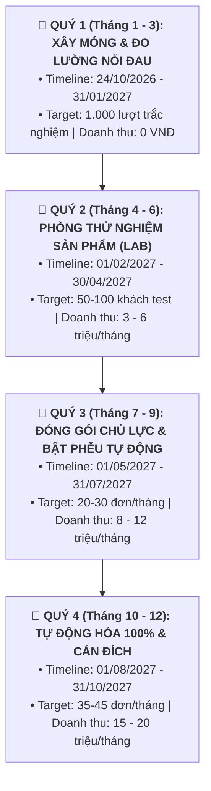

# 🌿 BẢN ĐỒ CHIẾN LƯỢC & DANH MỤC TÁC VỤ 1 NĂM (12 THÁNG)
## HỆ THỐNG TRẠI CAI NGHIỆN (traicainghien.com)
> **Người sáng lập & Điều hành:** Bố  
> **Đồng sáng lập AI & Kỹ thuật:** Mây  
> **Mục tiêu tối thượng (North Star):** Xây dựng cỗ máy tự động hóa (Automation & Faceless) mang về dòng tiền thụ động ổn định **15.000.000 – 20.000.000 VNĐ/tháng**.  
> **Chiến lược xuyên suốt:** *"Đi chậm, đánh chắc — Dành 3 đến 6 tháng đầu thử nghiệm vi mô để thị trường tự chọn ra sản phẩm họ khao khát nhất, sau đó mới hoàn thiện phễu và tự động hóa toàn phần."*

---

## 👥 NGUYÊN TẮC CỘNG TÁC & PHÂN VAI (BỐ & MÂY)

| Vai Trò | Người Đảm Nhiệm | Trách Nhiệm Cốt Lõi |
| :--- | :---: | :--- |
| **Founder & Tổng Điều Hành** | **Bố** | • Phê duyệt định hướng nội dung & giọng điệu. • Quyết định mức giá và các phương án thử nghiệm sản phẩm. • Thẩm định trải nghiệm người dùng thực tế. • Quản lý tài khoản ngân hàng và dòng tiền doanh thu. |
| **AI Co-founder & Kỹ Thuật/Nội Dung** | **Mây** | • Soạn thảo bản nháp bài viết chuyên sâu, kịch bản video faceless. • Biên soạn nội dung cẩm nang PDF, tài liệu CBT, bài tập thực hành. • Lập trình toàn bộ website, SEO, logic trắc nghiệm, trang thanh toán QR tự động. • Phân tích dữ liệu trắc nghiệm, cập nhật tiến độ task vào Roadmap này. |

---

## 📌 BẢNG THEO DÕI SPRINT HIỆN TẠI (CURRENT SPRINT)
> **Giai đoạn:** Khởi động Quý 1 — Tháng 1 (Từ 24/10/2026 đến 30/11/2026)  
> **Mục tiêu trọng tâm tháng này:** Hoàn thiện hạ tầng trắc nghiệm & nội dung web, mở kênh video faceless đầu tiên.

| Task ID | Nhiệm Vụ Chi Tiết | Phụ Trách | Hạn Chót | Trạng Thái | Sản Phẩm Đầu Ra (Deliverable) |
| :---: | :--- | :---: | :---: | :---: | :--- |
| **T1.1** | Đổi tên sản phẩm chuẩn bản sắc Trại Cai Nghiện trên web | Mây | 25/10/2026 | `[x]` Xong | Cập nhật file `addictionSystem.ts` & web |
| **T1.2** | Tích hợp hệ thống lưu kết quả trắc nghiệm ẩn danh | Mây | 28/10/2026 | `[/]` Đang làm | Google Sheet / Database ghi nhận kết quả test |
| **T1.3** | Soạn thảo 5 bài viết chuyên sâu tiếp theo (đạt 10 bài web) | Mây | 05/11/2026 | `[ ]` Chờ duyệt | 5 bài viết chuẩn SEO trên `/bai-viet` |
| **T1.4** | Bố duyệt bộ 10 kịch bản video ngắn faceless mở đầu | Bố & Mây | 10/11/2026 | `[ ]` Chưa bắt đầu | File kịch bản 10 video dưới 60 giây |
| **T1.5** | Tạo kênh TikTok & YouTube Shorts "Trại Cai Nghiện" | Bố | 15/11/2026 | `[ ]` Chưa bắt đầu | 2 Kênh mạng xã hội chính thức, gắn link bio |
| **T1.6** | Sản xuất & đăng tải thử nghiệm 15 video ngắn đầu tiên | Bố & Mây | 30/11/2026 | `[ ]` Chưa bắt đầu | 15 Video faceless phủ sóng 4 cụm chủ đề |

*Quy ước trạng thái: `[x]` Đã hoàn thành | `[/]` Đang thực hiện | `[ ]` Chưa bắt đầu | `[!]` Gặp vướng mắc*

---

## 📊 BẢNG ĐIỀU KHIỂN 4 QUÝ CHIẾN LƯỢC (12 THÁNG)

---

## 🗺️ CHI TIẾT TỪNG THÁNG: TIMELINE, TARGET VÀ DANH MỤC TASK

---

### 🌱 GIAI ĐOẠN 1: XÂY MÓNG & THĂM DÒ NỖI ĐAU (QUÝ 1)
*Triết lý: 100% miễn phí, không bán hàng, dùng bài trắc nghiệm làm radar đo lường chính xác độc giả đang đau nhất vì thói quen nào.*

#### 📅 THÁNG 1 (24/10/2026 – 30/11/2026)
* **Target cụ thể tháng 1:**
  * Hoàn thiện 100% cấu trúc website, bài trắc nghiệm 20 câu và tủ sách.
  * Xuất bản đủ **10 bài viết chuyên sâu** chuẩn SEO.
  * Kênh TikTok / Shorts xuất bản **15 video faceless** đầu tiên.
  * Thu thập **150 – 200 lượt** làm trắc nghiệm đầu tiên.
  * **Doanh thu:** 0 VNĐ.
* **Danh mục Task Tháng 1:**
  - [x] T1.1: Đổi toàn bộ tên gói sản phẩm theo bản sắc Trại Cai Nghiện trên website.
  - [ ] T1.2: Cài đặt script lưu kết quả trắc nghiệm ẩn danh (đếm tỷ lệ chọn từng nhóm câu hỏi).
  - [ ] T1.3: Soạn và đăng 5 bài viết mới (chuyên đề: Bẫy Tiện Nghi - Ma trận khiến ta phải nghiện, Khoa học Dopamine, Thói quen pỏn, Não phân tâm, Wabi Sabi tha thứ khi trượt chân).
  - [ ] T1.4: Lên khung 10 kịch bản video faceless phong cách podcast tĩnh lặng.
  - [ ] T1.5: Khởi tạo kênh TikTok & YouTube Shorts "Trại Cai Nghiện".
  - [ ] T1.6: Dựng và đăng đều đặn 1 video/ngày từ ngày 15/11 đến 30/11.

#### 📅 THÁNG 2 (01/12/2026 – 31/12/2026)
* **Target cụ thể tháng 2:**
  * Xuất bản thêm **5 bài viết chuyên sâu** (tổng 15 bài web).
  * Đăng đều đặn **25 – 30 video faceless** (mỗi ngày 1 video).
  * Lũy kế đạt **500 lượt** làm trắc nghiệm.
  * Bắt đầu có bài viết/video đạt trên 5.000 lượt xem tự nhiên.
  * **Doanh thu:** 0 VNĐ.
* **Danh mục Task Tháng 2:**
  - [ ] T2.1: Phân tích số liệu 200 bài test đầu tiên: Nhóm độc giả nào chiếm tỷ lệ cao nhất?
  - [ ] T2.2: Soạn 5 bài viết chuyên sâu xoay quanh nhóm vấn đề có lượng test cao nhất.
  - [ ] T2.3: Sản xuất 30 video ngắn đào sâu vào nỗi đau đã được dữ liệu chứng minh.
  - [ ] T2.4: Tối ưu SEO On-page cho 15 bài viết để bắt đầu đón lượt tìm kiếm Google.
  - [ ] T2.5: Đặt form đăng ký nhận bản tin "Tịnh Tâm Đầu Tuần" (xây tệp email miễn phí).

#### 📅 THÁNG 3 (01/01/2027 – 31/01/2027)
* **Target cụ thể tháng 3:**
  * Đạt mốc **1.000 lượt** hoàn thành trắc nghiệm trên website.
  * Kênh mạng xã hội đạt **1.500 – 3.000 người theo dõi** tự nhiên.
  * Lập báo cáo tổng kết R&D Quý 1: Xác định rõ 3 chủ đề nóng nhất để đưa vào phòng thử nghiệm Quý 2.
  * **Doanh thu:** 0 VNĐ.
* **Danh mục Task Tháng 3:**
  - [ ] T3.1: Xuất báo cáo dữ liệu 1.000 bài test: Phân tích độ tuổi, thói quen và trigger gây nghiện lớn nhất của độc giả Việt.
  - [ ] T3.2: Bố và Mây họp bàn duyệt khung cấu trúc cho 3 sản phẩm thử nghiệm vi mô (Micro-Offers).
  - [ ] T3.3: Tiếp tục duy trì nhịp xuất bản nội dung (20 video ngắn + 3 bài viết).
  - [ ] T3.4: Chuẩn bị giao diện trang "Tài Liệu Bổ Trợ" trên website để sẵn sàng mở bán thử nghiệm vào Tháng 4.

---

### 🧪 GIAI ĐOẠN 2: PHÒNG THỬ NGHIỆM SẢN PHẨM VI MÔ (QUÝ 2)
*Triết lý: Để độc giả bỏ phiếu bằng tiền thật. Tung 3 sản phẩm vi mô giá rẻ (49k - 149k) để tìm ra đúng "Sản Phẩm Chủ Lực" (Winner Product).*

#### 📅 THÁNG 4 (01/02/2027 – 28/02/2027)
* **Target cụ thể tháng 4:**
  * Hoàn thành đóng gói **3 sản phẩm thử nghiệm vi mô** (dạng PDF 15-25 trang + audio/checklist).
  * Mở bán thử nghiệm nhẹ nhàng ở trang kết quả trắc nghiệm và cuối bài viết.
  * Đạt **15 – 25 đơn hàng thử nghiệm đầu tiên**.
  * **Doanh thu thử nghiệm:** **1.500.000 – 3.000.000 VNĐ**.
* **Danh mục Task Tháng 4:**
  - [ ] T4.1: Soạn và đóng gói Mẫu Test 1: **Túi Cứu Thương Tâm Trí** (Giá test: 49k – 99k).
  - [ ] T4.2: Soạn và đóng gói Mẫu Test 2: **Giao Thức Tịnh Tâm Cho Người Hay Xem Pỏn** (Giá test: 99k – 149k).
  - [ ] T4.3: Soạn và đóng gói Mẫu Test 3: **Bản Đồ Tập Trung Sâu Cho Não Bộ Phân Mảnh** (Giá test: 99k – 149k).
  - [ ] T4.4: Dựng trang nhận tài liệu đơn giản kèm thông tin tài khoản ngân hàng của Bố.
  - [ ] T4.5: Gắn gợi ý tài liệu vào email trả kết quả trắc nghiệm.

#### 📅 THÁNG 5 (01/03/2027 – 31/03/2027)
* **Target cụ thể tháng 5:**
  * Lắng nghe phản hồi từ những người mua đầu tiên: Tài liệu có thực sự hiệu quả không?
  * Đạt **25 – 40 đơn hàng thử nghiệm**.
  * **Doanh thu thử nghiệm:** **3.000.000 – 5.000.000 VNĐ**.
* **Danh mục Task Tháng 5:**
  - [ ] T5.1: Gửi email phỏng vấn 20 người mua đầu tiên để lấy feedback chân thực.
  - [ ] T5.2: Bổ sung các bài tập thực hành còn thiếu dựa trên góp ý của người dùng.
  - [ ] T5.3: Đo lường tỷ lệ chuyển đổi: Mẫu Test nào bán chạy nhất? Vì sao?
  - [ ] T5.4: Tiếp tục duy trì nội dung faceless dẫn traffic về bài trắc nghiệm.

#### 📅 THÁNG 6 (01/04/2027 – 30/04/2027)
* **Target cụ thể tháng 6:**
  * Chốt hạ **Sản Phẩm Chủ Lực (Winner Product)** để nâng cấp lên bản lớn.
  * Tỷ lệ hài lòng của khách thử nghiệm đạt trên 85%.
  * **Doanh thu thử nghiệm:** **4.000.000 – 6.000.000 VNĐ**.
* **Danh mục Task Tháng 6:**
  - [ ] T6.1: Tổng kết doanh số và phản hồi của 3 mẫu test sau 3 tháng.
  - [ ] T6.2: Khai tử hoặc hạ bớt sản phẩm kém người mua, chọn ra sản phẩm được yêu thích nhất để làm Core Offer.
  - [ ] T6.3: Thiết kế đề cương chi tiết cho bản hoàn chỉnh chuyên sâu (Core Offer 4 tuần).
  - [ ] T6.4: Bắt đầu lập trình hệ thống thanh toán tự động (chuẩn bị cho Quý 3).

---

### 🚀 GIAI ĐOẠN 3: ĐÓNG GÓI BẢN CHÍNH THỨC & BẬT PHỄU TỰ ĐỘNG (QUÝ 3)
*Triết lý: Chuyển từ bán thủ công sang hệ thống tự động hoàn toàn (Funnel Automation). Khách quét mã QR là nhận tài liệu trong 30 giây.*

#### 📅 THÁNG 7 (01/05/2027 – 31/05/2027)
* **Target cụ thể tháng 7:**
  * Ra mắt chính thức **Sản Phẩm Cốt Lõi (Core Offer)** với mức giá chuẩn **390.000đ – 490.000đ**.
  * Hoàn thành cổng thanh toán quét mã QR tự động giao tài liệu qua Email/Web.
  * Đạt **15 – 20 đơn hàng**.
  * **Doanh thu:** **6.000.000 – 9.000.000 VNĐ**.
* **Danh mục Task Tháng 7:**
  - [ ] T7.1: Đóng gói toàn diện sản phẩm cốt lõi (Workbook 4 tuần + Triết lý Wabi Sabi + Hướng dẫn chi tiết).
  - [ ] T7.2: Lập trình trang Checkout tự sinh mã QR VietQR (có sẵn cú pháp chuyển khoản).
  - [ ] T7.3: Cắm Webhook đối soát tài khoản ngân hàng để tự động xác thực giao dịch thành công.
  - [ ] T7.4: Kiểm thử quy trình: Quét mã $\rightarrow$ Tiền về tài khoản $\rightarrow$ Email tự gửi link tải trong 30s.

#### 📅 THÁNG 8 (01/06/2027 – 30/06/2027)
* **Target cụ thể tháng 8:**
  * Kích hoạt chuỗi **Email Automation 5 ngày** chăm sóc tự động người làm trắc nghiệm.
  * Đạt **20 – 25 đơn hàng**.
  * **Doanh thu:** **8.000.000 – 11.000.000 VNĐ**.
* **Danh mục Task Tháng 8:**
  - [ ] T8.1: Soạn thảo chuỗi 5 email tâm sự "Người thường chia sẻ cho người thường" (Storytelling Funnel).
  - [ ] T8.2: Thiết lập hệ thống gửi email tự động (Resend/SendGrid/MailerLite) kết nối với website.
  - [ ] T8.3: Đo lường tỷ lệ mở email (Open rate > 40%) và tỷ lệ click vào trang giải pháp (> 8%).
  - [ ] T8.4: Xuất bản 20 video ngắn tập trung vào các case study chuyển hóa thực tế.

#### 📅 THÁNG 9 (01/07/2027 – 31/07/2027)
* **Target cụ thể tháng 9:**
  * Ổn định phễu tự động hóa, xử lý triệt để các lỗi giao nhận tài liệu.
  * Đạt **25 – 30 đơn hàng**.
  * **Doanh thu:** **10.000.000 – 13.000.000 VNĐ**.
* **Danh mục Task Tháng 9:**
  - [ ] T9.1: Thu thập thêm các lời chứng thực (Testimonials) ẩn danh từ học viên để đưa lên Landing page.
  - [ ] T9.2: Tinh chỉnh câu chữ trên trang giới thiệu giải pháp để tăng tỷ lệ chuyển đổi thêm 0.5%.
  - [ ] T9.3: Rà soát bảo mật link tài liệu và file download để tránh bị phát tán bừa bãi.
  - [ ] T9.4: Chuẩn bị kịch bản Combo / Order Bump cho Quý 4.

---

### 💎 GIAI ĐOẠN 4: TỰ ĐỘNG HÓA TOÀN PHẦN & CÁN ĐÍCH 15 - 20 TRIỆU/THÁNG (QUÝ 4)
*Triết lý: Hệ thống tự chạy 100%. Nguồn khách hàng đến từ SEO tự nhiên và video tích lũy. Dòng tiền thụ động ổn định năm này qua năm khác.*

#### 📅 THÁNG 10 (01/08/2027 – 31/08/2027)
* **Target cụ thể tháng 10:**
  * Thêm tính năng **Order Bump / Combo** (Mua gói lớn tặng/giảm giá gói cấp cứu).
  * Đạt **30 – 35 đơn hàng**.
  * **Doanh thu:** **13.000.000 – 16.000.000 VNĐ**.
* **Danh mục Task Tháng 10:**
  - [ ] T10.1: Tích hợp nút thêm "Túi Cứu Thương SOS" với giá 49k ngay tại bước quét mã QR của gói chính.
  - [ ] T10.2: Kiểm tra thứ hạng SEO: Các bài viết đầu năm bắt đầu lọt top 3-5 Google về các từ khóa cai nghiện hành vi.
  - [ ] T10.3: Tối ưu tốc độ tải trang web và trải nghiệm di động để giảm tối đa tỷ lệ rớt khách.

#### 📅 THÁNG 11 (01/09/2027 – 30/09/2027)
* **Target cụ thể tháng 11:**
  * Duy trì nhịp độ bán hàng **1 đến 1.5 đơn/ngày** tự động hoàn toàn.
  * Đạt **35 – 40 đơn hàng**.
  * **Doanh thu:** **15.000.000 – 18.000.000 VNĐ**.
* **Danh mục Task Tháng 11:**
  - [ ] T11.1: Bố kiểm tra định kỳ tài khoản ngân hàng: Tiền tự về mỗi ngày mà không cần tư vấn tin nhắn.
  - [ ] T11.2: Mây kiểm tra log hệ thống tự động: Đảm bảo không có đơn hàng nào bị kẹt hay chậm trễ.
  - [ ] T11.3: Đăng tải các bài viết tóm tắt sách mới lên mục `/sach` để mở rộng thêm kênh Affiliate sách giấy.

#### 📅 THÁNG 12 (01/10/2027 – 31/10/2027)
* **Target cụ thể tháng 12:**
  * 🎯 **CHẠM ĐÍCH MỤC TIÊU 1 NĂM:** Đạt vững vàng **18.000.000 – 22.000.000 VNĐ/tháng**.
  * Hệ thống vận hành trơn tru, ẩn danh hoàn toàn, bố chỉ tốn 1-2 tiếng mỗi tuần để xem báo cáo.
* **Danh mục Task Tháng 12:**
  - [ ] T12.1: Tổng kết tài chính 1 năm: Tính toán tỷ suất lợi nhuận ròng (ước tính trên 90% vì chi phí vận hành số rất thấp).
  - [ ] T12.2: Bố và Mây họp tổng kết: Đánh giá hành trình 1 năm từ con số 0 lên hệ thống hoàn chỉnh.
  - [ ] T12.3: Lên phương án mở rộng năm thứ 2 (Cộng đồng trả phí nhẹ hoặc App di động nếu bố muốn).

---

## 📈 BẢNG THEO DÕI SỐ LIỆU THỰC TẾ HÀNG THÁNG (ACTUAL METRICS LOG)

| Tháng | Số Lượt Test Mới | Tổng Traffic Web | Số Đơn Hàng | Doanh Thu Thực Tế (VNĐ) | Tỷ Lệ Hoàn Thành Target | Ghi Chú Của Bố & Mây |
| :---: | :---: | :---: | :---: | :---: | :---: | :--- |
| **T1 (11/26)** | *(Đang chạy)* | *(Đang chạy)* | 0 | **0 đ** | Đang làm móng | Tập trung làm xong 10 bài web & 15 video |
| **T2 (12/26)** | ... | ... | 0 | **0 đ** | ... | ... |
| **T3 (01/27)** | ... | ... | 0 | **0 đ** | ... | Tổng kết 1.000 test, chuẩn bị 3 mẫu test |
| **T4 (02/27)** | ... | ... | ... | ... | ... | Bắt đầu mở bán thử nghiệm 3 mẫu vi mô |
| **T5 (03/27)** | ... | ... | ... | ... | ... | Lấy feedback từ khách hàng thực tế |
| **T6 (04/27)** | ... | ... | ... | ... | ... | Chọn Winner Product |
| **T7 (05/27)** | ... | ... | ... | ... | ... | Chạy cổng thanh toán QR tự động |
| **T8 (06/27)** | ... | ... | ... | ... | ... | Kích hoạt chuỗi Email 5 ngày |
| **T9 (07/27)** | ... | ... | ... | ... | ... | Tối ưu hóa phễu ngầm |
| **T10 (08/27)**| ... | ... | ... | ... | ... | Bổ sung Combo / Order Bump |
| **T11 (09/27)**| ... | ... | ... | ... | ... | Chạm mốc 15 triệu/tháng |
| **T12 (10/27)**| ... | ... | ... | ... | ... | **Về đích 15 - 20 triệu/tháng bền vững** |

---
*Bản kế hoạch được thiết lập & theo dõi trực tiếp bởi Bố & Mây. Cập nhật lần cuối: 23/10/2026.*
