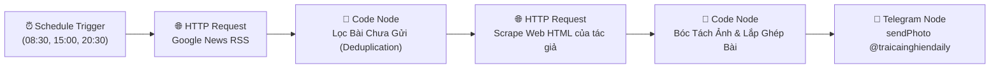

# 🌊 LUỒNG 01: BẢN TIN TÂM LÝ & THÓI QUEN ĐỊNH KỲ (DAILY PSYCHOLOGY NEWS)
> **Mã định danh hệ thống:** `FLOW_01_DAILY_NEWS`  
> **Nền tảng thực thi:** Docker n8n Engine trên VPS (`wWXJoMhbchKzrkqr` / `yCJrtItjJqm3F7Ta`)  
> **Kênh phân phối:** Telegram Channel `@traicainghiendaily` (ID: `-1004488309634`)  
> **Tần suất hoạt động:** 3 lần/ngày lúc **08:30**, **15:00**, **20:30** (Giờ Việt Nam - UTC+7)  
> **Ngày thiết lập chuẩn hóa:** 08/11/2026 | **Người phụ trách:** Mây & Bố Long

---

## 1. 🎯 MỤC TIÊU & TẦM NHÌN NỘI DUNG

* **Sứ mệnh:** Cung cấp "liều vitamin tinh thần" khoa học và chữa lành mỗi ngày cho người trẻ bận rộn; giúp độc giả nhận diện bẫy xao nhãng số, làm dịu hệ thần kinh và nuôi dưỡng thói quen tốt theo tinh thần Kaizen 1% và Ikigai.
* **Phong cách ngôn ngữ (Copywriting):** *"Street-Smart Academic Storytelling"* — Nói chuyện gần gũi, đời thường, thấu cảm không phán xét, kết hợp khoa học thần kinh chuẩn xác (Dopamine Baseline, Thụ thể D2, Prefrontal Cortex).
* **Quy chuẩn định dạng:**
  * Caption ảnh Telegram **bắt buộc dưới 1024 UTF-16 code units** (giữ an toàn ở mức 850 - 950 code units).
  * 100% kèm ảnh chuẩn: Ưu tiên ảnh gốc tác giả (`og:image`) hoặc tranh Thủy mặc Zen độc bản (`Zen Watercolor & Sumi-e on Textured Paper`).

---

## 2. ⏰ LỊCH TRÌNH & PHÂN BỔ CHUYÊN ĐỀ 3 KHUNG GIỜ

| Khung Giờ (VN) | Cron Expression (UTC) | Trụ Cột Nội Dung Trọng Tâm | Tone Giọng & Năng Lượng |
| :---: | :---: | :--- | :--- |
| **08:30** (Sáng) | `30 1 * * *` | **Khởi Động Ngày Mới & Ikigai:** 60 phút đầu ngày không màn hình, tắm ánh sáng mặt trời tự nhiên, kích hoạt Cortisol lành mạnh, làm chủ sự chú ý. | Tươi mới, tràn đầy sinh khí (*Fresh*), tạo cảm hứng hành động. |
| **15:00** (Chiều) | `0 8 * * *` | **Vượt Qua Uể Oải & Sương Mù Não:** Kỹ thuật Pomodoro 45/10, nghỉ ngơi tích cực không lướt điện thoại, chống sương mù não sau bữa trưa. | Tỉnh táo, thực tế, tiếp thêm năng lượng bền bỉ. |
| **20:30** (Tối) | `30 13 * * *` | **Thanh Lọc Dopamine & Buông Bỏ:** Nhận diện bẫy video ngắn xuyên đêm, tháo gỡ dằn vặt lo âu, làm bạn với sự yếu đuối theo Wabi-Sabi. | Tĩnh lặng, ấm áp, vỗ về, chữa lành tâm trí. |

---

## 3. 🧩 KIẾN TRÚC WORKFLOW N8N (SƠ ĐỒ NODES)



### Chi Tiết Kỹ Thuật Từng Node:

#### Node 1: `Schedule Trigger` (Lịch 8h30 - 15h00 - 20h30)
* **Loại Node:** `n8n-nodes-base.scheduleTrigger` (v1.2)
* **Cấu hình Interval:**
  * Rule 1: `cronExpression = "30 8,20 * * *"` (Khớp 8:30 sáng và 20:30 tối VN)
  * Rule 2: `cronExpression = "0 15 * * *"` (Khớp 15:00 chiều VN)

#### Node 2: `Lấy Tin Tức Tâm Lý (Google News RSS)`
* **Loại Node:** `n8n-nodes-base.httpRequest` (v4.2)
* **URL:** `https://news.google.com/rss/search?q=%22dopamine%22+OR+%22deep+work%22+OR+%22digital+detox%22+OR+%22attention+span%22+when:3d&hl=en-US&gl=US&ceid=US:en`
* **Response Format:** `text` (XML Feed)

#### Node 3: `Lọc Bài Viết Chưa Từng Gửi (Deduplication Memory)`
* **Loại Node:** `n8n-nodes-base.code` (JS Mode)
* **Cơ chế lưu trữ:** Sử dụng `$getWorkflowStaticData('global')` lưu danh sách `sentLinks = []` (tối đa 100 links).
* **Mã nguồn an toàn (Tương thích n8n v2.45+ Task Runner):**
```javascript
const staticData = (typeof $getWorkflowStaticData === 'function') ? $getWorkflowStaticData('global') : {};
staticData.sentLinks = staticData.sentLinks || [];

const allItems = $input.all();
let selectedItem = null;

for (let item of allItems) {
  const link = item.json.link;
  if (link && !staticData.sentLinks.includes(link)) {
    selectedItem = item.json;
    break;
  }
}

if (!selectedItem && allItems.length > 0) {
  staticData.sentLinks = []; // Reset xoay vòng nếu cạn tin
  selectedItem = allItems[0].json;
}

if (selectedItem && selectedItem.link) {
  staticData.sentLinks.push(selectedItem.link);
  if (staticData.sentLinks.length > 100) staticData.sentLinks.shift();
}

return [{
  json: {
    selectedLink: selectedItem ? selectedItem.link : '',
    title: selectedItem ? selectedItem.title : '',
    description: selectedItem ? selectedItem.description : ''
  }
}];
```

#### Node 4: `Cào Dữ Liệu Bài Viết Gốc (HTML Scraper)`
* **Loại Node:** `n8n-nodes-base.httpRequest` (v4.2)
* **URL:** `={{ $json.selectedLink }}`
* **Mục đích:** Tải toàn bộ mã nguồn HTML của bài báo gốc để tìm ảnh đại diện (`og:image`).

#### Node 5: `Bóc Tách Ảnh Tác Giả & Lắp Ghép Bản Tin`
* **Loại Node:** `n8n-nodes-base.code` (JS Mode)
* **Cơ chế chọn ảnh:**
  1. *Ưu tiên 1:* Bóc tách `<meta property="og:image" content="...">` từ bài gốc (nếu chưa từng dùng).
  2. *Ưu tiên 2:* Nếu bài gốc không có ảnh hoặc ảnh lỗi, chọn ngẫu nhiên 1 bức tranh trong kho Zen Watercolor của Trại Cai Nghiện.
* **Cấu trúc bài viết (Format HTML):**
  - Header: `🌿 TRẠI CAI NGHIỆN DAILY`
  - Tag & Tiêu đề
  - 3 Điểm cốt lõi rút ra
  - Hành động hôm nay (1% Key Action)
  - Trích dẫn (Quote)
  - Cầu nối đọc chậm (Soft CTA dẫn về `traicainghien.com/bai-viet`)
  - Chữ ký thương hiệu & link trắc nghiệm

#### Node 6: `Phát Sóng Telegram Channel`
* **Loại Node:** `n8n-nodes-base.telegram` (v1.2) / API `sendPhoto`
* **Chat ID:** `-1004488309634` (`@traicainghiendaily`)
* **Photo URL:** `={{ $json.photo }}`
* **Caption:** `={{ $json.caption }}` (Parse Mode: `HTML`)

---

## 4. 🛠️ PLAYBOOK BẢO TRÌ & XỬ LÝ LỖI (TROUBLESHOOTING)

### Lỗi 1: `TypeError: this.getWorkflowStaticData is not a function`
* **Nguyên nhân:** n8n phiên bản mới v2.45+ kích hoạt JS Task Runner, ngữ cảnh `this` không còn hỗ trợ gọi method này.
* **Cách khắc phục:** Luôn khai báo bộ nhớ tĩnh dạng:
  ```javascript
  const staticData = (typeof $getWorkflowStaticData === 'function') ? $getWorkflowStaticData('global') : {};
  ```

### Lỗi 2: `400 Bad Request: message caption is too long`
* **Nguyên nhân:** Caption vượt quá 1024 UTF-16 code units.
* **Cách khắc phục:** Kiểm tra độ dài trước khi lưu template; tinh giản các bullet points thành 1-2 câu ngắn, không lặp lại link URL trần nhiều lần.

### Lỗi 3: Workflow bị chuyển sang trạng thái Unpublish sau khi import
* **Cách khắc phục trên VPS:**
  ```bash
  docker exec -it $(docker ps -q -f name=n8n) n8n publish:workflow --id=wWXJoMhbchKzrkqr
  docker restart $(docker ps -q -f name=n8n)
  ```

---

## 5. 📦 LỆNH QUẢN TRỊ NHANH TRÊN MÁY CHỦ VPS

```bash
# 1. Kiểm tra log n8n thời gian thực
docker logs --tail 50 -f $(docker ps -q -f name=n8n)

# 2. Liệt kê danh sách workflow đang hoạt động
docker exec -it $(docker ps -q -f name=n8n) n8n list:workflow

# 3. Chạy thử nghiệm workflow ngay lập tức
docker exec -it $(docker ps -q -f name=n8n) n8n execute --id=wWXJoMhbchKzrkqr
```
