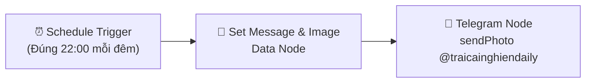

# 🛏️ LUỒNG 02: LỜI NHẮC ĐI NGỦ DỊU DÀNG (BEDTIME GENTLE ROUTINE)
> **Mã định danh hệ thống:** `FLOW_02_BEDTIME_REMINDER`  
> **Nền tảng thực thi:** Docker n8n Engine trên VPS (`E6PVBHKrtYPlfevu`)  
> **Kênh phân phối:** Telegram Channel `@traicainghiendaily` (ID: `-1004488309634`)  
> **Tần suất hoạt động:** Mỗi đêm đúng **22:00** (Giờ Việt Nam - UTC+7)  
> **Ngày thiết lập chuẩn hóa:** 08/11/2026 | **Người phụ trách:** Mây & Bố Long

---

## 1. 🎯 MỤC TIÊU & Ý NGHĨA BIỂU TƯỢNG

* **Sứ mệnh:** Điểm tựa bình an cuối ngày cho cộng đồng Trại Cai Nghiện. Tạo ra một "nghi thức chuyển tiếp" (Bedtime Boundary) giúp người trẻ tách mình khỏi ánh sáng xanh kích thích của điện thoại, dập tắt các vòng lặp suy nghĩ miên man (*Overthinking*) và đi vào giấc ngủ tự nhiên.
* **Quy chuẩn văn phong:**
  * **Tuyệt đối không dùng:** Từ ngữ mang tính áp đặt, mệnh lệnh hà khắc như *"Lệnh giới nghiêm"*, *"Bắt buộc tắt máy"*.
  * **Thay thế bằng:** Ngôn từ nhẹ nhàng, êm dịu, bao dung, như lời dặn dò của một người thân thương trước giờ ngủ: *"Đến giờ đi ngủ rồi bạn ơi, tắt điện thoại và đi ngủ thôi..."*
* **Cơ sở khoa học:**
  * Ánh sáng xanh bước sóng 450-480nm từ smartphone ức chế tuyến tùng tiết ra hormone Melatonin trong tối thiểu 90 phút.
  * Việc đặt điện thoại xa giường 2m tạo ra lực cản vật lý (Friction), giúp giảm 80% xung động với tay cầm máy lướt mạng vô thức giữa đêm.

---

## 2. 🎨 QUY CHUẨN MỸ CẢM & BỨC TRANH ĐỘC BẢN

* **File tranh chính thức:** `public/images/bedtime_gentle_bedroom.webp` (98 KB)
* **Trường phái nghệ thuật:** *Japandi Minimalist & Zen Watercolor* (Màu nước Thủy mặc kết hợp phong cách Bắc Âu - Nhật Bản tối giản).
* **Mô tả bối cảnh tranh:**
  * Một góc phòng ngủ đương đại tối giản, sạch sẽ, ấm cúng.
  * Chiếc giường gỗ phủ ga be dịu mắt, trên bàn đầu giường là chiếc đèn ngủ ánh vàng dịu tỏa quầng sáng êm ả.
  * Bên ngoài khung cửa kính lớn là thành phố đêm lung linh ánh đèn xa xa, tạo cảm giác an trú tuyệt đối giữa lòng đô thị náo nhiệt.
  * Chiếc điện thoại úp mặt nằm yên trên bàn cách xa giường, thể hiện sự buông bỏ hoàn toàn.

---

## 3. 🧩 KIẾN TRÚC WORKFLOW N8N (SƠ ĐỒ NODES)



### Chi Tiết Cấu Hình Từng Node:

#### Node 1: `Schedule Trigger` (Đúng 22h00 đêm)
* **Loại Node:** `n8n-nodes-base.scheduleTrigger` (v1.2)
* **Cấu hình Interval:**
  * `cronExpression = "0 22 * * *"` (Khớp đúng 22:00 đêm giờ Việt Nam)

#### Node 2: `Chuẩn Bị Lời Nhắc Đi Ngủ & Ảnh Japandi`
* **Loại Node:** `n8n-nodes-base.set` hoặc `n8n-nodes-base.code`
* **Tham số dữ liệu:**
  * `photo`: `https://traicainghien.com/images/bedtime_gentle_bedroom.webp`
  * `caption`:
```html
🌿 <b>TRẠI CAI NGHIỆN DAILY</b>

🏷 <b>[LỜI NHẮC BUỔI TỐI • BÌNH YÊN TRƯỚC GIỜ NGỦ]</b>
👉 <b>Đến giờ đi ngủ rồi bạn ơi, tắt điện thoại và đi ngủ thôi...</b>

Bạn đã nỗ lực hết mình cho cả một ngày dài rồi. Mọi áp lực, lo toan hay những điều còn dang dở — hãy nhẹ nhàng gác lại sau cánh cửa phòng ngủ.

🌙 <b>Một chút vỗ về cho bộ não của bạn đêm nay:</b>
• <b>Tắt ánh sáng màn hình:</b> Cho mắt bạn được nghỉ ngơi, để tuyến tùng tự nhiên giải phóng Melatonin ru bạn vào giấc ngủ sâu.
• <b>Quy tắc 2 mét:</b> Úp chiếc điện thoại xuống và đặt nó cách xa giường ngủ. Khoảng cách vật lý nhỏ này là tấm khiên bảo vệ giấc ngủ của bạn.
• <b>Hít thở chậm:</b> Thả lỏng hai vai, hít một hơi thật sâu và thở ra thật dài. Cảm nhận sự tĩnh lặng và an lành đang bao bọc lấy bạn.

🌱 <i>"Ngày mai sẽ là một ngày mới với một phiên bản tươi mới của chính bạn. Hãy ngủ một giấc thật ngon và trọn vẹn nhé!"</i>

======
🌿 <b>Trại Cai Nghiện — Trở về phiên bản tốt nhất của bạn</b>
<a href="https://traicainghien.com">Website</a> | <a href="https://traicainghien.com/trac-nghiem">Trắc nghiệm</a> | <a href="https://www.facebook.com/traicainghienvn2026">Fanpage</a>
```

#### Node 3: `Phát Sóng Telegram Channel`
* **Loại Node:** `n8n-nodes-base.telegram` (v1.2)
* **Thao tác:** `sendPhoto`
* **Chat ID:** `-1004488309634` (`@traicainghiendaily`)
* **Parse Mode:** `HTML`

---

## 4. 🛠️ PLAYBOOK BẢO TRÌ & XỬ LÝ LỖI (TROUBLESHOOTING)

### Lỗi 1: Ảnh không hiển thị trên Telegram (Photo load failed)
* **Nguyên nhân:** URL ảnh `https://traicainghien.com/images/bedtime_gentle_bedroom.webp` chưa được Vercel deploy hoặc sai đường dẫn tĩnh.
* **Cách khắc phục:**
  1. Kiểm tra trực tiếp URL trên trình duyệt xem ảnh có tải về bình thường không.
  2. File gốc lưu tại `public/images/bedtime_gentle_bedroom.webp` trên codebase. Đảm bảo file tồn tại và đã được commit lên branch `main`.

### Lỗi 2: Trùng lặp múi giờ máy chủ (Timezone Mismatch)
* **Hiện tượng:** Bản tin chạy lúc 15:00 UTC (tức 22:00 VN) nhưng nếu container n8n chạy múi giờ địa phương khác thì có thể lệch 7 tiếng.
* **Quy chuẩn bất di bất dịch:** Cấu hình cron rõ ràng theo `0 22 * * *` với n8n timezone `Asia/Ho_Chi_Minh` hoặc `0 15 * * *` nếu hệ thống chạy UTC.

---

## 5. 📦 LỆNH QUẢN TRỊ NHANH TRÊN MÁY CHỦ VPS

```bash
# 1. Chạy thử nghiệm workflow nhắc ngủ ngay lập tức
docker exec -it $(docker ps -q -f name=n8n) n8n execute --id=E6PVBHKrtYPlfevu

# 2. Xuất workflow thành file JSON backup
docker exec -it $(docker ps -q -f name=n8n) n8n export:workflow --id=E6PVBHKrtYPlfevu --output=/root/wf_bedtime_backup.json
```
