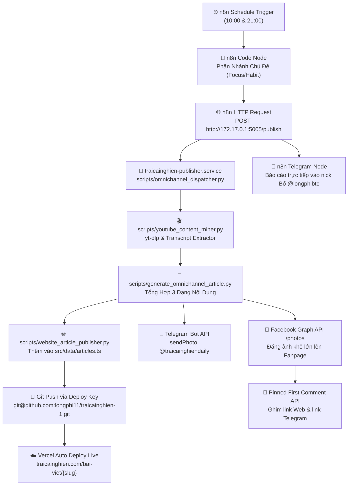

# 🚀 LUỒNG 03: ĐÀO YOUTUBE & XUẤT BẢN NỘI DUNG ĐA KÊNH (OMNICHANNEL ENGINE)
> **Mã định danh hệ thống:** `FLOW_03_OMNICHANNEL_ENGINE`  
> **Nền tảng thực thi:** Docker n8n Workflow (`Lj3wvfAe0CEqnWbQ`) kết nối Bridge Service (`:5005`) trên VPS  
> **Kênh phân phối đồng bộ:**
> 1. Website: `traicainghien.com/bai-viet/{slug}` (Next.js + Vercel)
> 2. Facebook Fanpage: *Trại Cai Nghiện* (`1232949796570940`)
> 3. Telegram Channel: `@traicainghiendaily` (`-1004488309634`)
> 4. Báo cáo riêng Bố: Telegram `@longphibtc` (`488901419`)  
> **Tần suất hoạt động:** 2 lần/ngày lúc **10:00** (Tập Trung) và **21:00** (Thói Quen) (Giờ Việt Nam - UTC+7)  
> **Ngày thiết lập chuẩn hóa:** 08/11/2026 | **Người phụ trách:** Mây & Bố Long

---

## 1. 🎯 MỤC TIÊU & BẢN CHẤT HỆ THỐNG

* **Định vị:** Đây là cỗ máy khai thác tri thức và phân phối đa kênh mạnh mẽ nhất của Trại Cai Nghiện.
* **Cơ chế hoạt động:**
  1. Tự động tìm kiếm các video có lượng xem và tương tác cao nhất trên YouTube (hàng trăm ngàn đến hàng triệu views) về 2 chủ đề cốt lõi: **Tập Trung (Focus / Deep Work)** và **Thói Quen (Habits / Kaizen)**.
  2. Bóc tách 100% transcript tiếng Việt của video hoàn toàn tự động (không tốn phí API).
  3. Sử dụng trí tuệ AI tái cấu trúc nội dung thành 3 sản phẩm độc lập nhưng gắn kết chặt chẽ:
     * **Bài nghiên cứu chuyên sâu trên Website** (chuẩn cấu trúc Wabi-Sabi, SEO Schema, tranh độc bản).
     * **Bài đăng Facebook Fanpage dạng "Curiosity Gap"** kèm ảnh full-size khổ lớn và tự động ghim First Comment chứa link Web.
     * **Bản tóm tắt súc tích trên Kênh Telegram Daily** kèm link đọc chậm.
  4. Tự động `git commit` & `git push` qua **Deploy Key** để Vercel tự động build và deploy live trong 30 giây.
  5. Tự động gửi link báo cáo trực tiếp vào Telegram riêng của Bố.

---

## 2. ⏰ LỊCH TRÌNH VẬN HÀNH TRÊN N8N & MÁY CHỦ VPS

### Phân Bổ Điều Khiển Qua n8n Workflow (`Lj3wvfAe0CEqnWbQ`):
* **Lịch kích hoạt:** Đúng **10:00 Sáng** (Tập Trung Sâu) và **21:00 Tối** (Thói Quen Tốt) hàng ngày.
* **Cơ chế gọi:** n8n gọi HTTP Webhook qua mạng nội bộ Docker đến `http://172.17.0.1:5005/publish` (Dịch vụ `traicainghien-publisher.service` chạy nền bằng systemd trên VPS).
* **Báo cáo n8n:** n8n nhận kết quả JSON trực tiếp và gửi thông báo live về Telegram riêng của Bố (`@longphibtc`).

### Lịch Trình Cron Còn Lại Trên VPS (`crontab -l`):
```cron
# 06:30 Sáng VN: Báo cáo kế hoạch & tương tác cho Bố
30 6 * * * cd /root/traicainghien && python3 scripts/telegram_reporter.py --type morning >> /root/traicainghien/cron_morning.log 2>&1

# 22:30 Đêm VN: Báo cáo kiểm toán tổng hợp ngày cho Bố
30 22 * * * cd /root/traicainghien && python3 scripts/telegram_reporter.py --type audit >> /root/traicainghien/cron_audit.log 2>&1
```

---

## 3. 🧩 SƠ ĐỒ LUỒNG DỮ LIỆU ĐA KÊNH (DATA PIPELINE)



---

## 4. 🔑 CÁC MODULE SOURCE CODE CỐT LÕI

| Module Script | Chức Năng Chính | File Liên Quan |
| :--- | :--- | :--- |
| `scripts/youtube_content_miner.py` | Quét top video YouTube theo từ khóa, lọc video đã xử lý, bóc tách toàn bộ phụ đề tiếng Việt. | `scripts/processed_youtube_videos.json` |
| `scripts/generate_omnichannel_article.py` | Biên soạn bài viết Web sâu sắc, tóm tắt Telegram và bài đăng Facebook Curiosity Gap. | `src/data/articles.ts` |
| `scripts/website_article_publisher.py` | Tự động Git-Sync kéo code mới nhất, chèn bài vào `rawArticles`, kiểm toán chống đè Registry và kích hoạt Git commit & push an toàn. | `scripts/audit_all_articles.js`, `src/data/article_registry.json` |
| `scripts/omnichannel_dispatcher.py` | Tổng đạo diễn điều phối: Đào ➔ Viết ➔ Đẩy Git ➔ Đăng Tele ➔ Đăng Facebook ➔ Báo cáo Bố. | `cron_focus.log`, `cron_habit.log` |
| `scripts/telegram_reporter.py` | Trợ lý riêng của Bố: Gửi báo cáo xuất bản tức thì, bản tin 06:30, bản kiểm toán 22:30 và cảnh báo lỗi. | Telegram Chat ID: `488901419` |

---

## 5. 🛡️ QUY CHUẨN KỸ THUẬT & BẢO MẬT BẮT BUỘC

### 5.1. Cơ Chế Chống Đè Phiên Bản & Bảo Vệ Toàn Vẹn Dữ Liệu (Data Integrity Gate - LỆNH ĐẶC BIỆT CỦA BỐ):
1. **Auto Git-Sync First:** Bắt buộc tự động chạy `git pull --rebase` từ GitHub trước khi chèn bất kỳ bài viết mới nào vào `src/data/articles.ts`, đảm bảo VPS luôn có toàn bộ bài viết mới nhất mà Bố con làm từ máy cá nhân.
2. **Sổ Đăng Ký Registry & Van Một Chiều:** Script kiểm toán tự động đối chiếu với `src/data/article_registry.json`. Kho bài viết CHỈ ĐƯỢC PHÉP TĂNG LÊN, tuyệt đối không được giảm đi.
3. **Auto-Rollback on Audit Failure:** Nếu phát hiện bài viết bị thiếu hoặc vi phạm tiêu chuẩn $\rightarrow$ Tự động hoàn tác (revert) file về trạng thái an toàn ban đầu và hủy lệnh push.
4. **Đồng Bộ Assets:** Khi commit bắt buộc `git add` đồng thời file bài viết, file registry và thư mục ảnh `public/images/articles/`, sau đó push cả 2 remote (`origin` và `fork`).

1. **Deploy Key GitHub (Không bao giờ hết hạn):**
   * VPS sử dụng khóa riêng `/root/.ssh/id_traicainghien_deploy` kết nối với Deploy Key `VPS Trai Cai Nghien` trên GitHub `longphi11/traicainghien-1`.
   * Quyền hạn: **Read/Write**. Đẩy code tự động không cần mật khẩu hay token tạm thời.
2. **Page Access Token Facebook (Never Expiring - Vĩnh viễn):**
   * Cấu hình trong `.env.local` qua biến `FB_PAGE_ACCESS_TOKEN`.
   * Token này có `Expires: Never`, cho phép gọi Facebook Graph API `/photos` và `/comments` vô hạn định mà không bao giờ bị hết hạn giữa chừng.
3. **Quy tắc Curiosity Gap trên Facebook:**
   * Tuyệt đối không chèn link trực tiếp trong caption bài post Facebook (thuật toán sẽ giảm 70% lượt hiển thị).
   * Link bài viết Web và link nhóm Telegram luôn được đẩy tự động vào **Bình Luận Đầu Tiên (First Comment)** và ghim lên đầu.
4. **Quy chuẩn Hình ảnh độc bản (Lệnh thép của Bố):**
   * Mỗi bài viết mới bắt buộc có thumbnail riêng biệt, dung lượng dưới 120KB WebP, vượt qua kiểm toán nhị phân MD5 chống trùng lặp `audit_all_articles.js`.

---

## 6. 🛠️ PLAYBOOK BẢO TRÌ & XỬ LÝ LỖI (TROUBLESHOOTING)

### Lỗi 1: `fatal: could not read Username for 'https://github.com'`
* **Nguyên nhân:** Remote git trên VPS đang dùng giao thức HTTPS không có thông tin đăng nhập.
* **Cách khắc phục:** Chuyển remote sang SSH Deploy Key:
  ```bash
  cd /root/traicainghien && git remote set-url origin git@github.com:longphi11/traicainghien-1.git
  ```

### Lỗi 2: `OAuthException: Error validating access token`
* **Nguyên nhân:** User token bị đổi mật khẩu hoặc ứng dụng Meta bị thu hồi quyền.
* **Cách khắc phục:** Truy cập Meta Graph API Explorer, lấy lại Page Access Token dài hạn và cập nhật vào `/root/traicainghien/.env.local`.

### Lỗi 3: Bài đăng Web bị lỗi 404
* **Nguyên nhân:** Quá trình `git push` từ VPS lên GitHub bị nghẽn nên Vercel chưa kích hoạt build.
* **Cách khắc phục:** 
  1. Kiểm tra log VPS: `tail -n 50 /root/traicainghien/cron_focus.log`
  2. Kích hoạt lệnh đẩy thủ công trên VPS: `cd /root/traicainghien && git push origin main`
